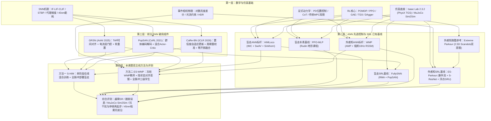

# 面向复杂障碍环境的脉冲强化学习机器人运动控制方法研究
## —— 毕设完整知识体系、论文精讲与代码审计、可复用资源及实验设置全指南

> **课题信息**：四川大学计算机学院 · 人工智能专业 · 本科毕业论文（设计）  
> **研究目标**：以 Unitree A1 四足机器人为载体、Isaac Lab 2.3.2（Isaac Sim 5.1）为仿真底座，在保持与先进 ANN 控制范式（HIMLoco、WMP）相近的复杂地形越障能力前提下，引入前沿脉冲机制（GRSN、CaRe-BN、PopSAN），实现纯本体盲走 **S-HIM** 与外感知视觉跑酷 **Event-Spiking-WMP（ES-WMP）** 的全脉冲部署与数量级理论推理节能，并完成 MuJoCo Sim2Sim、多维抗干扰与帕累托前沿评测。  
> **实证与零幻觉声明**：本文档所有数学公式、超参数、实验数据与对比结论均直接核验自用户 Zotero 本地文献库（集合 `本科毕设` `75DQYIW4`，共 66 篇；含本次定向补齐下载入库的 21 篇基础与复现核心文献至子集合 `基础与复现补充文献` `96QHRDJ5` 及为原有 3 篇文献补挂的 PDF，共 64 篇含本地可直跳 PDF）以及本机 4 大工作区与 18 个已克隆开源仓库源码。凡属“原文报告值”“官方代码实测值”“本机已验证值”或“本课题待验证拟定方案”，均在文中明确区分标注。

---

## 目录

- [第一章：课题全局技术脉络与知识依赖图谱](#第一章课题全局技术脉络与知识依赖图谱)
- [第二章：毕设全流程必掌握的基础知识体系（Foundations）](#第二章毕设全流程必掌握的基础知识体系foundations)
  - [2.1 强化学习与足式运动控制数学基础](#21-强化学习与足式运动控制数学基础)
  - [2.2 脉冲神经网络（SNN）与脉冲强化学习（SRL）基础](#22-脉冲神经网络snn与脉冲强化学习srl基础)
  - [2.3 神经形态事件相机与 GPU 并行物理仿真基础](#23-神经形态事件相机与-gpu-并行物理仿真基础)
- [第三章：核心论文逐篇进阶知识精讲与“论文 vs 代码”深度审计](#第三章核心论文逐篇进阶知识精讲与论文-vs-代码深度审计)
  - [3.1 纯本体盲走越障演化线（Lee / RMA / Rudin / HIMLoco）](#31-纯本体盲走越障演化线lee--rma--rudin--himloco)
  - [3.2 外感知视觉跑酷与世界模型线（AMP / Extreme Parkour / Dreamer-RSSM / WMP）](#32-外感知视觉跑酷与世界模型线amp--extreme-parkour--dreamer-rssm--wmp)
  - [3.3 脉冲连续控制与前沿 SNN 关键创新线（PopSAN / FullySNN / ES-Parkour / tdBN / SEW-ResNet / GRSN / CaRe-BN）](#33-脉冲连续控制与前沿-snn-关键创新线popsan--fullysnn--es-parkour--tdbn--sew-resnet--grsn--care-bn)
- [第四章：毕设可直接复用的本机资源、开源代码库与现状诊断](#第四章毕设可直接复用的本机资源开源代码库与现状诊断)
  - [4.1 本机算力边界与 Conda 环境实测清单](#41-本机算力边界与-conda-环境实测清单)
  - [4.2 本机 4 大工作区可复用代码与资产全景](#42-本机-4-大工作区可复用代码与资产全景)
  - [4.3 已克隆的 18 个上游开源仓库复用矩阵](#43-已克隆的-18-个上游开源仓库复用矩阵)
  - [4.4 本机已有冒烟/验证结果深度诊断与 5 项关键待修补问题](#44-本机已有冒烟验证结果深度诊断与-5-项关键待修补问题)
- [第五章：毕设完整可落地的具体实验设置方案](#第五章毕设完整可落地的具体实验设置方案)
  - [5.1 统一物理仿真、载体接口、地形与事件合成底座设置](#51-统一物理仿真载体接口地形与事件合成底座设置)
  - [5.2 任务一：S-HIM 纯本体盲走基线复现与消融实验设置](#52-任务一s-him-纯本体盲走基线复现与消融实验设置)
  - [5.3 任务二：Event-Spiking-WMP 外感知蒸馏基线复现与消融实验设置](#53-任务二event-spiking-wmp-外感知蒸馏基线复现与消融实验设置)
  - [5.4 统一评测协议：MuJoCo Sim2Sim、多维抗干扰、45nm 能耗核算与帕累托前沿](#54-统一评测协议mujoco-sim2sim多维抗干扰45nm-能耗核算与帕累托前沿)
  - [5.5 RTX 5060 Ti 16GB 算力排程与 18 周分阶段验收清单](#55-rtx-5060-ti-16gb-算力排程与-18-周分阶段验收清单)
- [第六章：GB/T 7714-2015 参考文献目录与 Zotero 实证溯源核验总表](#第六章gbt-7714-2015-参考文献目录与-zotero-实证溯源核验总表)
  - [6.1 完整参考文献目录（GB/T 7714-2015 顺序编码制）](#61-完整参考文献目录gbt-7714-2015-顺序编码制)
  - [6.2 Zotero 实证溯源与入库核验总表](#62-zotero-实证溯源与入库核验总表)
  - [6.3 PaperQA2 高置信度历史证据卡复用映射表](#63-paperqa2-高置信度历史证据卡复用映射表)

---

## 第一章：课题全局技术脉络与知识依赖图谱

本课题横跨**足式机器人深度强化学习（Legged DRL）**、**基于世界模型的视觉跑酷（MBRL / Visual Parkour）**、**脉冲神经网络与脉冲强化学习（SNN / SRL）**以及**神经形态事件视觉（Event-Based Vision）**四大方向。整个毕设围绕“**纯本体盲走（S-HIM）**”与“**外感知跑酷（Event-Spiking-WMP）**”两条主线展开，其知识与算法依赖关系如下：

### 核心文献按角色分层总览

为帮助在复现与撰写论文时快速定位知识源头，下表按“基础必修 / 盲走基线 / 视觉与世界模型 / SNN 与 SRL 进阶 / 事件仿真与平台工程”将核心 Zotero 文献分层归类：

| 知识层级 | 模块主题 | 核心文献（序号与简称） | Zotero 键 / 原文链接 | 在毕设中的具体作用 |
| :--- | :--- | :--- | :--- | :--- |
| **基础必修** | 具身智能与足式 DRL 综述 | [1] Liu 2025、[4] 董豪 2022 | [`LV6BHE6R`](zotero://open-pdf/library/items/AYRL3FDR?page=1) / [`WUFZDA7G`](zotero://open-pdf/library/items/52WEFRHC?page=1) | 课题背景、具身智能框架与 DRL 控制综述 |
| **基础必修** | 传统 MPC 与全身控制 | [5] Di Carlo 2018、[6] Kim 2020 | [`69A9DWDP`](zotero://open-pdf/library/items/4FQBQIRB?page=1) / [`TV3NH2G2`](zotero://open-pdf/library/items/BIJLJUDM?page=1) | 对比显式动力学建模在非结构地形的失配问题 |
| **基础必修** | PPO / GAE / TD3 / DAgger | [7] PPO、[8] GAE、[9] TD3、[10] DAgger | [`XCGEGLJR`](zotero://open-pdf/library/items/BCYE24AI?page=1) / [`J9C8HM7C`](zotero://open-pdf/library/items/F4ANAZSL?page=1) / [`7EW9X4AS`](zotero://open-pdf/library/items/DJTCG994?page=1) / [`SMPLBJTG`](zotero://open-pdf/library/items/DKZSRK3C?page=1) | 所有策略梯度、优势估计、Off-policy 对比与在线蒸馏理论底座 |
| **基础必修** | 仿真引擎与 Sim2Sim | [11] Isaac Gym、[12] Rudin、[13] Orbit、[14] Isaac Lab、[15] MuJoCo | [`HCMS6EW7`](zotero://open-pdf/library/items/6IUDXWC2?page=1) / [`W5BSTIP5`](zotero://open-pdf/library/items/R2JPXK5S?page=1) / [`P56C6XAX`](zotero://open-pdf/library/items/PW3V8DDQ?page=1) / [`FPR2HQTA`](zotero://select/library/items/FPR2HQTA) | GPU 并行物理仿真、地形课程机制、Isaac Lab 迁移与 MuJoCo 验证 |
| **盲走基线** | 特权师生与 RMA 适应 | [2] Miki 2022、[3] Lee 2020、[16] RMA | [`Z6BICYX6`](zotero://open-pdf/library/items/Z6YDNTKD?page=1) / [`XBWD8BLW`](zotero://open-pdf/library/items/GACGAAX6?page=1) / [`IQCHL5DN`](zotero://open-pdf/library/items/R9EFVALV?page=1) | 两阶段特权学习与环境外生变量适应（FullySNN 的直接上游） |
| **盲走基线** | IMC / SwAV / Sinkhorn / HIMLoco | [17] IMC、[18] SwAV、[19] Sinkhorn、[20] HIMLoco、[21] HIM-Humanoid | [`GT9NU749`](zotero://open-pdf/library/items/UU3DLQ65?page=1) / [`9DKEH9K5`](zotero://open-pdf/library/items/6G9YU7GD?page=1) / [`8IEMJYIL`](zotero://open-pdf/library/items/LCVIGHRE?page=1) / [`B9Q9MDVL`](zotero://open-pdf/library/items/54I7RGXG?page=1) | **S-HIM 的直接迁移源**，单阶段对比聚类隐式建模地形扰动 |
| **外感知基线** | 跑酷蒸馏与 AMP 运动先验 | [22] Extreme Parkour、[23] AMP 2021、[24] AMP-Hardware 2022 | [`3JZ98WV2`](zotero://open-pdf/library/items/G8JGVQ8M?page=1) / [`UL8HZL24`](zotero://open-pdf/library/items/8LKNKLHN?page=1) / [`22XAVEKB`](zotero://open-pdf/library/items/5NNCQJZK?page=1) | 内积跑酷奖励、边缘惩罚、LSGAN 风格先验与动捕重定向 |
| **外感知基线** | RSSM 世界模型与 WMP | [25] PlaNet、[26] DreamerV2、[27] DreamerV3、[28] WMP | [`JGP4C2Q7`](zotero://open-pdf/library/items/WABYYR4Z?page=1) / [`IYBHP8HA`](zotero://open-pdf/library/items/NADYWGG2?page=1) / [`2HDG3ZMY`](zotero://open-pdf/library/items/BDZXAGP2?page=1) / [`EBVZ936L`](zotero://open-pdf/library/items/MAQLVAMI?page=1) | **ES-WMP 的教师源头**，低频 10Hz RSSM + 离散潜变量 + 深度重构 |
| **SNN / SRL 核心** | 能耗基准与 SRL 基础 | [29] Horowitz、[30] 陈鼎综述、[31] R-STDP、[32] DQN-SNN、[33] STBP、[34] 代理梯度、[37] SpikingJelly | [`UBN4JN6J`](zotero://open-pdf/library/items/2AUFHGTL?page=1) / [`SRFUBBIS`](zotero://open-pdf/library/items/TFK2HRXZ?page=1) / [`RYWIF9ZE`](zotero://open-pdf/library/items/CUJVC7Z2?page=1) / [`D7CUZI4G`](zotero://open-pdf/library/items/PAZ8B3MV?page=1) / [`ERU5E38F`](zotero://open-pdf/library/items/JXHABDG2?page=1) | 45nm MAC/AC 能耗模型、STBP 梯度流、代理梯度与 SNN 工程实现 |
| **SNN / SRL 进阶** | 脉冲足式基线与前沿组件 | [35] tdBN、[36] SEW-ResNet、[38] PopSAN、[39] FullySNN、[40] ES-Parkour、[41] GRSN、[42] CaRe-BN、[43] Proxy Target | [`MHAC7Y8I`](zotero://open-pdf/library/items/IYTAIK6N?page=1) / [`IBPGKRF3`](zotero://open-pdf/library/items/LHCGGXK8?page=1) / [`X94ZEF8B`](zotero://open-pdf/library/items/J9KYXLZZ?page=1) / [`KBW3HN6C`](zotero://open-pdf/library/items/MX575FYP?page=1) / [`YAMRECRU`](zotero://open-pdf/library/items/UK6D8JQT?page=1) / [`6IVTCBWV`](zotero://open-pdf/library/items/LU3YFJJW?page=1) / [`RLESX45Q`](zotero://open-pdf/library/items/J2PBQYNA?page=1) | 脉冲连续控制、盲走/跑酷 SRL 对比基线、长时记忆与非平稳 RL 归一化 |
| **事件相机** | 神经形态视觉与事件仿真 | [44] Gallego 综述、[45] ESIM、[46] v2e、[47] EOLO、[48] EVIS、[49] 无人机神经形态 | [`DK4E697N`](zotero://open-pdf/library/items/Q5QTUQX9?page=1) / [`MV59PJA2`](zotero://open-pdf/library/items/8IEQ6743?page=1) / [`MU4XW64V`](zotero://open-pdf/library/items/D76PQAKC?page=1) / [`HNRT5CS7`](zotero://open-pdf/library/items/N7YDJUNX?page=1) / [`3L4EQLRV`](zotero://open-pdf/library/items/NCR2STEH?page=1) / [`L6J9SPU6`](zotero://open-pdf/library/items/8WM9FRRE?page=1) | 事件生成物理方程、单帧光流合成法与 Isaac Sim 高保真 HDR 事件验证 |

---

## 第二章：毕设全流程必掌握的基础知识体系（Foundations）

### 2.1 强化学习与足式运动控制数学基础

#### 1. POMDP 建模与非对称 Actor-Critic（Asymmetric Actor-Critic）
在真实非结构化地形中，四足机器人受限于机载传感器，无法直接读取地形摩擦系数、质心偏移、外力扰动或足下完整高程图，因此足式运动控制本质上是**部分可观测马尔可夫决策过程（POMDP）**，由六元组 $(\mathcal{S}, \mathcal{O}, \mathcal{A}, \mathcal{T}, r, \gamma)$ 定义 [28, p.2]：
- **状态与观测分离**：底层真实状态 $s_t = (o_t, s_t^{\text{pri}})$，其中部署期可得观测 $o_t$ 在盲走任务中仅为本体感知 $o_t^p$（角速度、重力投影、速度指令、关节位置与速度、上一时刻动作），在外感知任务中为 $(o_t^p, d_t)$ 或 $(o_t^p, e_t)$；而特权信息 $s_t^{\text{pri}}$（真实机身线速度、地形扫描点/高程图、足端接触力、外力与物理随机化参数）仅在仿真训练期可读 [20, p.4][28, p.2–4]。
- **优化目标**：寻找最优策略 $\pi^*: \mathcal{O} \to \mathcal{A}$ 最大化期望折扣累积回报：
$$
\pi^* = \arg\max_{\pi} \mathbb{E}_{s_{t+1}\sim \mathcal{T}(\cdot|s_t,a_t),\, a_t \sim \pi(\cdot|o_t)} \left[ \sum_{t=0}^{\infty} \gamma^t r(s_t, a_t) \right]
$$
- **非对称 Actor-Critic 的意义**：训练期令 Critic 价值网络 $V_\phi(o_t, s_t^{\text{pri}})$ 读取完整特权状态以获得低方差的价值估计，同时限制 Actor 策略网络仅以部署期可得的 $o_t$（及其历史特征）为输入，从而在不泄露未来不可用传感器的前提下显著加速 PPO 收敛。HIMLoco [20, p.4]、WMP [28, p.3]、PopSAN [38, p.2] 与本课题的 **S-HIM** 均严格遵循此范式（在 SRL 中进一步演进为“**ANN 特权 Critic 辅助训练 + 全脉冲 SNN Actor 独立部署**”）。

#### 2. PPO（近端策略优化）与 GAE（广义优势估计）
本课题所有在线 RL 基线（PPO-MLP、HIMLoco、FullySNN Phase 1、WMP、ES-Parkour Teacher 与 S-HIM）均采用 **PPO-Clip** [7, p.3–5] 与 **GAE** [8, p.2–4]：
- **GAE($\gamma, \lambda$) 优势估计**：定义单步时序差分（TD）残差 $\delta_t = r_t + \gamma V(s_{t+1})(1 - d_t) - V(s_t)$，则截断步长 $T$ 上的 GAE 递推形式为：
$$
\hat{A}_t^{\text{GAE}(\gamma, \lambda)} = \sum_{l=0}^{T-t-1} (\gamma \lambda)^l \delta_{t+l}, \quad \hat{R}_t = \hat{A}_t + V(s_t)
$$
  - **关键工程细节（超时自举 Time-out Bootstrapping）**：足式仿真中回合达到最大时长（如 `20s = 1000 steps`）而终止并非“摔倒失败”，必须区分真实失败终止（`terminated`，后继价值置 0）与时间上限截断（`time_outs`，须加回 $\gamma V(s_{\text{terminal}})$ 自举，见 [`MyHIMLoco/rsl_rl/rsl_rl/algorithms/him_ppo.py`](file:///home/qyw/MyHIMLoco/rsl_rl/rsl_rl/algorithms/him_ppo.py#L106-L109) 与 [`Graduation project/graduation/ppo.py`](file:///home/qyw/Graduation%20project/graduation/ppo.py#L7-L15)）。否则策略会在回合末期学到“惧怕时间截断”的畸变步态。
- **PPO-Clip 联合损失**：令新旧策略重要性采样比率 $r_t(\theta) = \frac{\pi_\theta(a_t|o_t)}{\pi_{\theta_{\text{old}}}(a_t|o_t)}$，标准化后的优势为 $\bar{A}_t$，则：
$$
\mathcal{L}^{\text{CLIP}}(\theta) = -\mathbb{E}_t \left[ \min\big(r_t(\theta)\bar{A}_t,\, \text{clip}(r_t(\theta), 1-\epsilon, 1+\epsilon)\bar{A}_t\big) \right]
$$
$$
\mathcal{L}^{\text{VF}}(\phi) = \mathbb{E}_t \left[ \max\Big((V_\phi - \hat{R}_t)^2,\, \big(V_{\text{old}} + \text{clip}(V_\phi - V_{\text{old}}, -\epsilon, \epsilon) - \hat{R}_t\big)^2\Big) \right]
$$
$$
\mathcal{L}_{\text{PPO}} = \mathcal{L}^{\text{CLIP}} + c_v \mathcal{L}^{\text{VF}} - c_e \mathcal{H}(\pi_\theta(\cdot|o_t))
$$
- **自适应 KL 学习率调度（RSL-RL 核心技巧）**：在 `rsl_rl` 框架下（HIMLoco、WMP、AMP 均采用），每个 mini-batch 后解析计算高斯策略的 KL 散度均值：
$$
D_{\text{KL}}\big(\mathcal{N}(\mu_{\text{old}}, \sigma_{\text{old}}^2) \,\|\, \mathcal{N}(\mu, \sigma^2)\big) = \sum_{j=1}^{12}\left[\ln\frac{\sigma_j}{\sigma_{\text{old},j}} + \frac{\sigma_{\text{old},j}^2 + (\mu_{\text{old},j} - \mu_j)^2}{2\sigma_j^2} - \frac{1}{2}\right]
$$
  当 $\bar{D}_{\text{KL}} > 2 \cdot \text{KL}_{\text{desired}}$（默认 $\text{KL}_{\text{desired}} = 0.01$）时学习率除以 $1.5$（下限 `1e-5`）；当 $0 < \bar{D}_{\text{KL}} < 0.5 \cdot \text{KL}_{\text{desired}}$ 时乘以 $1.5$（上限 `1e-2`）[12][20][24, p.5]。  
  > **【SNN 迁移警示】**：对于脉冲策略网络（S-HIM），由于代理梯度具有非精确性与步长敏感性，若开启自适应 KL 调度需适当收紧 `max_lr`（如 `1e-3`）并对 `log_std` 设上下界（如 `clamp(-5, 2)`，见 [`graduation/ppo.py`](file:///home/qyw/Graduation%20project/graduation/ppo.py#L23)），防止出现 `TRAINING_RESET_PARAMETER_AUDIT` 中观察到的“高熵导致动作标准差发散至 >3.5”的失稳闭环。

#### 3. Off-Policy 算法（TD3/SAC）与 On-Policy PPO 在 SRL 中的关键差异
- **为何必学**：PopSAN [38, p.3–4]、GRSN [41, p.5] 与 CaRe-BN [42, p.7,18–20] 的原论文连续控制基准主要在 MuJoCo 上用 **TD3** [9]（双 Q Critic 抑制高估、延迟策略更新、目标策略平滑噪声）和 **SAC** 验证。
- **迁移到足式 PPO 的核心差异**：
  1. Off-policy 算法拥有容量 $10^6$ 的历史经验回放池（Replay Buffer），CaRe-BN 原论文直接从回放池随机抽取 $M=100$ 个 mini-batch 执行周期重校准（Re-BN）[42, p.6,18]；
  2. 足式大规模并行仿真采用 On-policy **PPO**（每轮收集 `num_envs × steps` 如 $4096 \times 24 \approx 10^5$ 帧最新数据并清空缓冲），因此在 **S-HIM** 中，CaRe-BN 的 Re-BN 校准批次应直接从**当前轮次或近 $k$ 轮环形缓存的在线并行观测**中均匀抽样（如每轮或每 $T_{\text{cal}}$ 轮抽 `1024–4096` 帧执行前向无梯度校准并 `commit()`，见 [`graduation/spiking.py`](file:///home/qyw/Graduation%20project/graduation/spiking.py#L183-L189)）。

#### 4. DAgger 在线模仿学习与教师—学生蒸馏理论
- **行为克隆（BC）的复合误差困境**：仅在教师轨迹分布 $d_{\pi^*}$ 上监督学生 $\pi_\theta$，一旦部署期学生出现微小误差进入教师未曾访问的状态分布 $d_{\pi_\theta}$，误差将随时间步 $T$ 呈二次方 $O(\epsilon T^2)$ 级联发散 [10, p.2]。
- **DAgger（Dataset Aggregation）解耦思路**：在仿真闭环中让**学生策略（或按概率 $\beta_i$ 混合教师与学生动作）与环境真实交互**，并在学生实际访问到的状态 $s_t \sim d_{\pi_i}$ 上查询冻结的教师策略获取最优标签 $\pi^*(s_t)$，从而将复合误差界由 $O(\epsilon T^2)$ 降至线性 $O(\epsilon T)$ [10, p.3–4]。
- **在毕设中的直接落地**：
  - Extreme Parkour [22, p.6] 与 ES-Parkour [40, p.3–4] 采用 **Warmup（教师执行 rollout）→ DAgger（学生执行 rollout + 教师在线打标签）**；
  - 本课题 **ES-WMP** 同样采用“冻结 WMP 教师 + Warmup → 学生闭环 DAgger 交互 + 在线查询教师 $h_t^{\text{WMP}}$ 与 $a_t^{\text{WMP}}$”的蒸馏机制，确保全脉冲学生在面对轻微偏航、踏空或停顿后的状态分布时，依然能从冻结 WMP 教师处获得正确的纠偏隐状态与恢复动作。

#### 5. 足式机器人控制基础与 Unitree A1 物理规格
- **传统模型控制（MPC + WBIC）的局限**：MIT Cheetah 3 凸模型预测控制（Convex MPC）[5] 通过简化单刚体动力学（SRBD）在线求解二次规划预测未来时域足端反作用力，并结合全身冲量控制（WBIC）[6] 跟踪足端轨迹。其致命弱点是高度依赖精确刚体惯量/接触参数建模与显式地形高程估计，在碎石、松软斜面、打滑与未知落差下易模型失配 [3, p.1–2][20, p.3]。
- **端到端 RL 动作空间与显式 PD 控制**：Unitree A1 为 12 自由度中型四足机器人（每条腿含 Hip/Thigh/Calf 3 个执行器；站立髋高约 $26\text{ cm}$、身长约 $40\text{ cm}$、整机质量约 $12\text{ kg}$）[16, p.5][22, p.7]。策略以 $50\text{ Hz}$（$\Delta t_{\text{ctrl}} = 0.02\text{ s}$）输出相对默认站姿 $q_{\text{default}}$ 的偏移量 $a_t \in \mathbb{R}^{12}$，经缩放因子 $k = 0.25$ 得到目标关节角，再以 $200\text{ Hz}$（物理步长 $\Delta t_{\text{sim}} = 0.005\text{ s}$，`decimation = 4`）经关节 PD 控制器转化为力矩 [20, p.4][28, p.4]：
$$
q_d = q_{\text{default}} + 0.25 \cdot a_t, \qquad \tau = K_p (q_d - q) + K_d (0 - \dot{q})
$$
  其中 A1 典型增益在 HIMLoco/WMP 仿真中为 $K_p = 40\text{ N}\cdot\text{m/rad}, K_d = 1.0\text{ N}\cdot\text{m}\cdot\text{s/rad}$（HIMLoco 实机部署为 $K_p=30, K_d=0.75$；AMP 仿真为 $K_p=80, K_d=1.0$；RMA 为 $K_p=55, K_d=0.8$）[16, p.5][20, p.7][24][28, p.6]。
- **机械能耗评价指标（Cost of Transport, CoT）**：除计算芯片理论能耗外，评估步态是否自然节能还应辅以无量纲机械运输成本 [24, p.5]：
$$
\text{CoT} = \frac{\sum_{j=1}^{12} [\tau_j \dot{q}_j]_+}{m g \|v_{xy}\|_2}
$$
  其中 $[\cdot]_+ = \max(\cdot, 0)$ 表示电机正功。结合 ES-Parkour Table IV 的关节电机能耗对比 [40, p.6]，可确保 SNN 策略在降低芯片推理能耗的同时，不会因控制抖动而恶化关节机械能耗。

---

### 2.2 脉冲神经网络（SNN）与脉冲强化学习（SRL）基础

#### 1. 脉冲强化学习（SRL）三大范式对比
综述文献 [30] 与 GRSN [41, p.1–2] 将 SRL 划分为三条路线，清晰解释了本课题选择“**混合 Actor-Critic / 蒸馏 + STBP 代理梯度直接训练**”的理论依据：

| SRL 技术路线 | 代表文献 | 核心机理 | 优势 | 核心瓶颈（为何不单独采用） |
| :--- | :--- | :--- | :--- | :--- |
| **生物局部可塑性（R-STDP / 三因子规则）** | Bing 2019 [31] | 基于脉冲时间依赖可塑性 + 全局奖励调制资格迹更新突触权重 | 高度生物合理、支持片上无反传在线学习 | 缺乏全局精确梯度信用分配，难以扩展至 12-DoF 高维非结构地形连续控制 [38, p.2][39, p.1] |
| **ANN-to-SNN 离线转换** | Tan 2020 [32] | 将预训练 ReLU-ANN 的激活值通过权重/阈值归一化映射为 SNN 发放率 | 无需重新做 RL 探索、可直接继承 ANN 权重 | 需极大推理时间步（$T \ge 25\text{–}100$）才能压低转换误差，延迟与能耗剧增；无法利用 SNN 时序动态，且在连续控制闭环中存在误差逐帧放大 [38, p.2,7][42, p.3,10] |
| **直接训练（STBP + 代理梯度）与混合 AC / 蒸馏** | Wu 2018 [33]、Neftci 2019 [34]、PopSAN [38]、GRSN [41]、CaRe-BN [42] | 沿时空展开计算图，用光滑代理导数替代阶跃函数导数，端到端优化低时间步（$T=1\text{–}5$）SNN | 超低延迟（$T=1\text{–}4$）、充分利用膜电位/电流时空动态、可与 PPO/DAgger 无缝衔接 | 非平稳 RL 分布下易梯度爆炸/消失与死神经元（需 **CaRe-BN**）；传统 LIF 记忆短（需 **GRSN**） |

#### 2. 四类脉冲神经元动力学与重置机制对比
掌握不同论文采用的神经元离散动力学方程，是正确复现各基线与诊断发放率异常的关键：

| 神经元模型 | 离散动力学方程 | 重置机制 | 采用论文与本课题位置 |
| :--- | :--- | :--- | :--- |
| **IF（Integrate-and-Fire）** | $V[n] = V[n-1] + I[n],\; S[n] = \Theta(V[n] - V_{\text{th}})$ | Hard Reset: $V \leftarrow V(1-S)$ | ES-Parkour [40, p.5]（ResNet-18 与 3 层 Actor，$T=4$） |
| **标准 LIF（Leaky IF）** | $H_t = \lambda V_{t-1} + I_t,\; S_t = \Theta(H_t - V_{\text{th}})$ | Hard: $V_t = (1-S_t)H_t + S_t V_{\text{reset}}$ Soft: $V_t = H_t - V_{\text{th}} S_t$ | STBP [33]、tdBN [35]、CaRe-BN [42, p.3]、本课题 `S-HIM` / `ES-WMP` 的 `LIFActor` 与 `S-ConvNet` |
| **CLIF（Current-based LIF）** | $C_t = \lambda_c C_{t-1} + W S_t^{l-1} + b$ $V_t = \lambda_v V_{t-1}(1 - S_{t-1}) + C_t,\; S_t = \Theta(V_t - V_{\text{th}})$ | Hard Reset（$\lambda_c=0.5, \lambda_v=0.75, V_{\text{th}}=0.5$） | PopSAN [38, p.3]、FullySNN [39, p.2]、CaRe-BN 主对比 [42, p.17] |
| **GRSN（门控循环脉冲神经元）** | **论文 Eq.17 [41, p.5]**：$c_t^l = \mathcal{F}(o_t^{l-1})\odot c_{t-1}^l + (1-\mathcal{F}(o_t^{l-1}))\odot \mathcal{I}(o_t^{l-1})$ **官方代码 `GRSNCell`**：$c_t = \sigma(W_f o_{t-1})\odot c_{t-1} + (1-\sigma(W_f o_{t-1}))\odot \text{ReLU}(W_i o_{t-1})$，$u_t = \beta \hat{u}_{t-1} + (1-\beta)(W_x x_t + c_t)$ | **Soft Reset**：$\hat{u}_t = u_t - V_{\text{th}} o_t$，可学习 $\beta = \sigma(\beta_{\text{raw}})$ | GRSN [41]、本课题 **S-HIM 编码器** 与 **ES-WMP 时序记忆模块** |
| **Dynamic Neuron（DN）** | 二阶膜电位 $V$ 与恢复变量 $U$ 耦合（见 CaRe-BN 附录 D.2.3 Eq.23–25 [42, p.17–18]） | Hard Reset + $U \leftarrow U + \theta_s S$ | CaRe-BN 泛化对比 [42, p.17] |

> **关键理论对比——Hard Reset vs Soft Reset**：Hard Reset 在发放瞬间将膜电位强行清零，会丢弃超过阈值的超额残余电位 $(u_t - V_{\text{th}})$，在低时间步（尤其 TAP 单步 $T=1$）下造成严重的时序信息截断；Soft Reset 通过减法 $\hat{u}_t = u_t - V_{\text{th}} o_t$ 保留超额电位，显著降低浅层与短窗 SNN 的信息损失 [41, p.4–5]。

#### 3. STBP 时空反向传播与代理梯度（Surrogate Gradient）
由于脉冲发放函数 $o_t^l = \Theta(u_t^l - V_{\text{th}})$ 的真实导数为狄拉克冲激函数 $\delta(u_t^l - V_{\text{th}})$（几乎处处为 0、阈值处无穷大），直接 BPTT 无法传播梯度。**STBP** [33][35, p.4] 将迭代 LIF 展开为空间（层间 $l \to l+1$）与时间（帧间 $t \to t+1$）双维计算图，梯度链式法则为：
$$
\frac{\partial \mathcal{L}}{\partial o_t^l} = \sum_{j} \frac{\partial \mathcal{L}}{\partial u_{t,j}^{l+1}} \frac{\partial u_{t,j}^{l+1}}{\partial o_t^l} + \frac{\partial \mathcal{L}}{\partial u_{t+1}^l} \frac{\partial u_{t+1}^l}{\partial o_t^l}, \qquad
\frac{\partial \mathcal{L}}{\partial u_t^l} = \frac{\partial \mathcal{L}}{\partial o_t^l} \underbrace{h'(u_t^l - V_{\text{th}})}_{\text{代理导数}} + \frac{\partial \mathcal{L}}{\partial u_{t+1}^l} \frac{\partial u_{t+1}^l}{\partial u_t^l}
$$
**常用代理梯度函数对比**（核验自原文与代码）：
1. **矩形窗（Rectangular / Boxcar）**：$h'(x) = \frac{1}{2\omega}\mathbb{I}(|x| < \omega)$（PopSAN [38, p.11] 与 FullySNN 源码使用 $\omega=0.5$，注意源码未除 $2\omega$ 即高为 1；CaRe-BN [42, p.16] Eq.18 显式除 $2\omega$）。缺点：窗外梯度严格为 0，若膜电位整体偏离阈值则立即触发“死神经元”无法恢复。
2. **反正切（ATan）**：前向可表示为 $h(x) = \frac{1}{\pi}\arctan(\frac{\pi}{2}\alpha x) + \frac{1}{2}$，导数 $h'(x) = \frac{\alpha}{2[1 + (\frac{\pi}{2}\alpha x)^2]}$（GRSN [41, p.3] Eq.6 采用 $\alpha=2$；本机 [`graduation/spiking.py`](file:///home/qyw/Graduation%20project/graduation/spiking.py#L10-L12) 采用 $\alpha=2$，即 `atan(pi * x) / pi`，其导数在 $x=0$ 处为 $1$）。优点：全局有界且支撑集覆盖全实轴，死神经元仍有微弱恢复梯度。
3. **Fast Sigmoid（SuperSpike）**：$h'(x) = \frac{1}{(1 + \beta |x|)^2}$（Neftci 2019 [34, p.9]）。计算最轻量，同样具备长尾恢复特性。

#### 4. 45nm CMOS 理论能耗模型与学术严谨性边界
- **权威工艺基准**：Horowitz（ISSCC 2014）[29, p.2,5, Fig. 1.1.9] 给出 45nm 0.9V CMOS 工艺下的基础算术操作能耗：
  - 32-bit 浮点乘法（FP32 Mult）：$3.7\text{ pJ}$；
  - 32-bit 浮点加法（FP32 Add / **AC**）：$0.9\text{ pJ}$；
  - 32-bit 浮点乘加（FP32 **MAC** = Mult + Add）：$3.7 + 0.9 = 4.6\text{ pJ}$；
  - 8-bit / 32-bit 整型加法（Int Add）：$0.03\text{ pJ} / 0.1\text{ pJ}$。
- **突触操作数（SOPs）与理论总能耗公式**：
  - 对接收**连续浮点输入**的层（ANN 所有层，以及 SNN 直接接收连续本体观测或未脉冲化特征的编码首层/线性读出层），每条连接执行 1 次 MAC：$\text{MAC}_l = \text{FLOPs}_l$；
  - 对接收**二值脉冲 $\{0, 1\}$** 的脉冲层，仅当突触前神经元发放（$o=1$）时才触发一次权重累加（AC），其期望突触操作数为 [40, p.5][41, p.6]：
$$
\text{SOP}_l = \text{fr}_l \times T_l \times \text{FLOPs}_l \quad \text{（精确统计时直接按实际 } \sum \mathbb{I}(o=1)\cdot f_{\text{out}} \text{ 计数）}
$$
  - 单次控制决策（@50Hz）的理论突触能耗与等效平均功率为：
$$
E_{\text{decision}} = E_{\text{MAC}} \sum_{l \in \mathcal{L}_{\text{MAC}}} \text{MAC}_l + E_{\text{AC}} \sum_{l \in \mathcal{L}_{\text{AC}}} \text{AC}_l \quad (\text{pJ}), \qquad P_{\text{syn}} = E_{\text{decision}} \times f_{\text{ctrl}} \times 10^{-12} \quad (\text{W})
$$
  其中对于低频外感知视觉分支（$f_{\text{vis}} = 10\text{ Hz}$，即每 $k=5$ 个控制步推理一次），其折算到单次 50Hz 决策步的等效能耗必须**按比例除以 $k=5$**（即 $E_{\text{decision}} = E_{\text{50Hz}} + \frac{1}{5} E_{\text{10Hz}}$）。
- **必须向评委主动交代的学术严谨性边界**：Horowitz 原文第 5–6 节明确指出 [29, p.2–3]，45nm 下单次片外 DRAM 访存高达 $1\text{–}2\text{ nJ}$（比 FP32 MAC 高两个数量级），片上 8KB/32KB SRAM 访问约 $10\text{–}20\text{ pJ}$。因此基于 $4.6\text{ pJ} / 0.9\text{ pJ}$ 计算的是**神经形态事件驱动架构下的理论突触算术能耗**（不包含通用 GPU 的指令取指与片外 DRAM 搬运开销），该口径与 ES-Parkour [40, p.5]、FullySNN [39, p.4]、GRSN [41, p.6] 保持完全一致，但应在论文中显式注明“假定部署于存算一体神经形态芯片（如 Intel Loihi [38, p.7–8]）且按完整推理链路逐层精确挂钩统计”。

---

### 2.3 神经形态事件相机与 GPU 并行物理仿真基础

#### 1. 事件相机（DVS）物理机理与静态感知退化
- **异步对数对比度触发**：与传统 RGB/深度相机按固定帧率全局曝光不同，事件相机每个像素独立监测对数光强 $L(\mathbf{u}, t) = \ln I(\mathbf{u}, t)$，仅当相对上次触发时刻的改变量达到对比度阈值 $C > 0$ 时异步发射四元组事件 $e_k = (\mathbf{u}_k, t_k, p_k)$，极性 $p_k \in \{+1, -1\}$ [44, p.4][40, p.2]：
$$
\Delta L(\mathbf{u}, t_k) = L(\mathbf{u}, t_k) - L(\mathbf{u}, t_k - \Delta t_k) = p_k C
$$
- **光流—亮度恒常线性化模型**：在微小时间间隔 $\Delta t$ 内满足亮度恒常假设 $\frac{\partial L}{\partial t} + \nabla L \cdot \mathbf{v} = 0$，一阶泰勒展开即得 [44, p.4][40, p.2, Eq.4]：
$$
\Delta L(\mathbf{u}) \approx -\nabla L(\mathbf{u}) \cdot \mathbf{v}(\mathbf{u}) \Delta t
$$
  其中 $\nabla L = (\frac{\partial L}{\partial x}, \frac{\partial L}{\partial y})$ 为图像空间梯度，$\mathbf{v}(\mathbf{u})$ 为像素光流速度。
- **核心优势与致命短板**：事件相机拥有 $\ge 120\text{ dB}$ 超高动态范围（RGB 约 $60\text{ dB}$）、微秒级时间分辨率与天然无运动模糊特性 [40, p.4, Table I][44, p.3]；但由上式可见，**当机器人停顿或低速调整姿态导致光流 $\mathbf{v} \to \mathbf{0}$ 时，$\Delta L \to 0$，事件流迅速归零（静态场景退化）**！这正是本课题在 **ES-WMP** 中引入 **GRSN 脉冲长时记忆模块**并在第 5.4 节专门设计“停顿再起步”测试的物理根源！

#### 2. 四种事件相机仿真方案对比与选型依据

| 仿真方案 | 代表文献 & 本地仓库 | 物理机理 | 并行速度与闭环能力 | 优点与局限 | 本课题角色 |
| :--- | :--- | :--- | :--- | :--- | :--- |
| **单帧深度+光流差分** | EOLO [47]、ES-Parkour [40]、[`graduation/events.py`](file:///home/qyw/Graduation%20project/graduation/events.py) | 将深度图映射为对数伪亮度，用 Sobel 算子求 $\nabla L$，与光流点乘并按 $\pm C$ 阈值化 | **极快（纯 GPU 张量运算，支持 32–1024 并行闭环实时 RL/蒸馏）** | 不依赖昂贵 RTX 帧插值渲染；但需给平地添加微纹理，且随机光流近似弱于真实相机自运动光流（**改进点：可结合机器人真实速度+深度重投影计算解析光流**） | **主训练与闭环蒸馏模块**（与 ES-Parkour 同口径） |
| **EVIS（Isaac Sim 插件）** | Shi 2026 [48]、`third_party/upstream/isaac-sim-event-camera-plugin` | 基于 Isaac Sim RTX 线性 HDR 辐亮度 + 双向运动矢量（Motion Vector）插值 + Z-buffer 遮挡处理 | 支持 Isaac Sim 闭环，需 RTX 渲染管线（显存与帧率开销显著高于几何射线深度） | 物理保真度最高（线性 HDR、多阈值发射 $n=\lfloor \lvert\Delta L\rvert/C \rfloor$、真实光照与运动模糊） | **高保真评测/验证扩展路线**（低并行数验证 Sim2Real 光度鲁棒性） |
| **ESIM** | Rebecq 2018 [45]、`third_party/upstream/rpg_esim` | OpenGL/Unreal 渲染 + 运动自适应采样 | 仅离线/单实例，不支持 GPU 千级物理并行 | 经典开源标准，但不兼容 Isaac Lab | 仅作原理对照与文献参考 |
| **v2e** | Hu 2021 [46]、`third_party/upstream/v2e` | 对离线视频用 Super-SloMo 插帧 + 模拟 DVS 像素漏电/散粒噪声/不应期 | 离线视频转事件，无法交互闭环 | 噪声建模最精细（可用于给事件帧注入真实传感器噪声做抗干扰测试） | 传感器噪声模型参考 |

#### 3. Isaac Gym → Isaac Lab 迁移与 MuJoCo Sim2Sim 核心工程契约
NVIDIA Isaac Gym [11] 已停止维护，其官方继任者 Orbit [13] / **Isaac Lab** [14] 构建于 Isaac Sim 5.1（PhysX 5 TGS 求解器 + RTX/Warp 传感器）之上。根据本机 [`MyHIMLoco/isaaclab_migration/docs/MIGRATION_AUDIT.md`](file:///home/qyw/MyHIMLoco/isaaclab_migration/docs/MIGRATION_AUDIT.md) 与 [`AMP/papers/A1_AMP_IROS_2022_Gym_to_Lab_alignment.md`](file:///home/qyw/AMP/papers/A1_AMP_IROS_2022_Gym_to_Lab_alignment.md) 的实测审计，开展任何基线复现与 Sim2Sim 评测必须严格遵守以下 **6 条不可变接口契约**：
1. **关节顺序重排（最高频致错点）**：Legged Gym / 策略网络采用腿优先顺序（`FL_hip, FL_thigh, FL_calf, FR_..., RL_..., RR_...`），而 Isaac Lab 原生按关节树广度优先排列（`4 hips, 4 thighs, 4 calves`），边界处必须执行显式索引映射 `Policy → Lab = [0, 4, 8, 1, 5, 9, 2, 6, 10, 3, 7, 11]` 并按关节名运行时校验。
2. **四元数分量约定**：Isaac Gym 与多数 `legged_gym` 数学工具采用 `(x, y, z, w)`，Isaac Lab 与 MuJoCo 均采用 `(w, x, y, z)`，重力投影与偏航角计算边界必须显式转换。
3. **显式力矩 PD 控制等价性**：为了与原版 `legged_gym` 的每物理子步（200Hz）显式力矩截断行为严格对齐，Isaac Lab `ImplicitActuatorCfg` 的隐式 `stiffness` 与 `damping` 必须置 `0`，在每个物理子步手动计算 $\tau = \text{clip}(K_p(q_d - q) - K_d\dot{q}, -\tau_{\max}, \tau_{\max})$ 下发。
4. **USD 固定足端刚体保留（`dont_collapse`）**：默认 URDF→USD 转换会将固定关节连接的 `foot` 合并进 `calf`，导致 `calf` 非法接触终止在站立第 1 步就误触发；必须像 [`AMP/reference/AMP_for_hardware_A1/converted/a1_official_urdf_generated.usd`](file:///home/qyw/AMP/reference/AMP_for_hardware_A1/converted/a1_official_urdf_generated.usd) 那样对 4 个足端固定关节设置 `dont_collapse` 以保留独立 `foot` 接触传感器。
5. **PhysX 求解器对齐**：统一采用 TGS（`solver_type=1`）、`num_position_iterations=4`、`num_velocity_iterations=0`、`contact_offset=0.01 m`、`rest_offset=0.0 m`。
6. **MuJoCo Sim2Sim 物理验证意义**：MuJoCo [15] 采用广义坐标下的平滑凸优化接触求解器，与 PhysX 的最大坐标 TGS 刚体接触求解器存在天然动力学差异；将在 Isaac Lab 中训得的 TorchScript 策略零样本迁移到本机 `/home/qyw/WMP/tmp/a1_mjcf/a1.xml`（MuJoCo 3.16.0）执行评测，可无硬件成本地检验控制策略的动力学鲁棒性与抗模型失配能力。

---

## 第三章：核心论文逐篇进阶知识精讲与“论文 vs 代码”深度审计

本章对毕设直接复现或深度借鉴的每一篇核心论文进行**逐篇深拆**，不仅提炼进阶算法机理与原文量化指标，更将论文文字与本机已克隆的官方源码逐项核对，揭示复现中极易踩坑的“论文—代码差异”。

### 3.1 纯本体盲走越障演化线（Lee / RMA / Rudin / HIMLoco）

#### 1. Lee et al. (Science Robotics 2020) [3] & Miki et al. (Science Robotics 2022) [2]：特权师生范式奠基
- **核心问题与机理**：在崎岖未知地形上直接用盲走本体感知训练 RL 策略极易因部分可观测而无法收敛。Lee et al. [3, p.3] 提出两阶段**特权学习（Privileged Learning）**：阶段一训练读取地面真实高程、足端接触力与摩擦系数的特权教师；阶段二用时间卷积网络（TCN）编码本体历史序列，通过监督模仿学习蒸馏出可部署的盲走学生。Miki et al. [2] 进一步融合本体感知与带噪机载高程图，通过注意力门控实现了泥泞、雪地、碎石等极端野外地形的鲁棒行走。
- **对本课题的启示**：确立了“特权信息辅助训练、纯传感器独立部署”的总思想，但两阶段行为蒸馏存在固有的信息瓶颈与特征失配，且 Lee et al. 依赖手工设计的足端轨迹生成器（FTG）[3, p.8]，促使后续 RMA 与 HIMLoco 向更端到端与单阶段演进。

#### 2. RMA (Kumar et al., RSS 2021) [16]：快速电机适应（FullySNN 的直接上游）
- **核心架构与公式** [16, p.2,4–5]：
  - **阶段一（Base Policy + Env Factor Encoder）**：将 17 维环境特权向量 $e_t$（机身质量与质心 3 维、12 个电机强度、地面摩擦 1 维、局部地形高度 1 维）经编码器 $\mu$ 映射为 8 维外生隐变量 $z_t = \mu(e_t)$，与当前 30 维本体状态 $x_t$、上一动作 $a_{t-1}$ 拼接输入基础策略 $\pi$，在仿真中用 PPO 联合训练（生物能学启发奖励：前进速度上限 $0.35\text{ m/s}$ + 做功 $|\tau^\top(q_t - q_{t-1})|$、冲击力、平滑度等 10 项）。
  - **阶段二（Adaptation Module $\phi$）**：冻结 $\pi$ 与 $\mu$，用 1D-CNN 接收过去 $k=50$ 步（$0.5\text{ s}$）状态-动作历史预测 $\hat{z}_t = \phi(x_{t-k:t-1}, a_{t-k:t-1})$，采用 **On-policy DAgger 方式**（用 $\phi$ 预测的 $\hat{z}_t$ 驱动环境，同时以真实 $z_t=\mu(e_t)$ 为监督目标）最小化 $\text{MSE}(\hat{z}_t, z_t)$ [16, p.5]。
  - **异步部署**：$\phi$ 运行在 $10\text{ Hz}$，$\pi$ 运行在 $100\text{ Hz}$（Unitree A1 实机，$K_p=55, K_d=0.8$），实现亚秒级在线适应 [16, p.5]。
- **核心局限（HIMLoco 批判点）**：不同环境物理参数组合（如高摩擦+斜坡 vs 低摩擦+载荷）可能对观测产生相似影响（**参数非唯一可辨识性**），且第二阶段回归隐变量仍存在模仿信息损失 [20, p.2–3]。

#### 3. Rudin et al. (CoRL 2022, `legged_gym`) [12]：大规模 GPU 并行训练与游戏化地形课程
- **核心突破**：基于 Isaac Gym [11] 在单张 GPU 上并行运行 **4096** 个物理环境，将整个物理缓冲与 PyTorch 张量留在显存内零 CPU 拷贝，并提出**游戏化地形难度课程（Game-Inspired Terrain Curriculum）**：按“单回合行进距离超过地形网格一半则升级、不足目标速度对应距离一半则降级”的动态规则组织 $10\text{ 行} \times 20\text{ 列}$ 地形矩阵，将复杂台阶/斜坡策略训练时间压缩至 **20 分钟以内** [12, p.2,7]。
- **对本课题的直接作用**：本课题所有盲走与跑酷基线的 `PPO-MLP`、地形课程、奖励缩放框架均源于 Rudin et al. 的 `legged_gym` / `rsl_rl` 范式。

#### 4. HIMLoco (Long et al., ICLR 2024) [20] & HIM-Humanoid [21]：本课题 S-HIM 的直接迁移标杆
- **核心洞察（经典 IMC 理论 [17] 的 RL 映射）**：外部环境属性（高程、摩擦、弹性、外力）本质上都是作用在机器人本体动力学上的**未知系统扰动**。受经典内部模型控制（Internal Model Control, IMC）[17][20, p.4–5] 启发，无需显式回归多解病态的环境参数，只需从历史本体观测 $o_{t-H:t}^a$ 预测机器人的**模拟响应（Hybrid Internal Embedding）** $(\hat{v}_t, \hat{l}_t)$：其中 $\hat{v}_t \in \mathbb{R}^3$ 显式跟踪线速度，$\hat{l}_t \in \mathbb{R}^{16}$ 隐式表征稳定性/扰动状态。
- **SwAV 对比聚类 + Sinkhorn-Knopp 最优传输（Hybrid Internal Optimization, HIO）** [18][19][20, p.5]：
  - 将历史序列 $o_{t-H:t}^a$ 经 Source Encoder 映射并 $L_2$ 归一化得到单位超球面特征 $l_t^{\text{source}}$，将下一时刻本体状态 $o_{t+1}^a$ 经 Target Encoder 映射并 $L_2$ 归一化得到 $l_t^{\text{target}}$（同一轨迹前后帧互为正样本，同 batch 其余环境为负样本，充分利用 GPU 大批量并行带来的多地形批次信息）。
  - 维护 $K$ 个单位归一化可学习原型矩阵 $E = \{\bar{e}_1, \dots, \bar{e}_K\}$，计算软聚类预测概率（温度 $\tau$）：
$$
p_{t,k}^{\text{source}} = \frac{\exp\left(\frac{1}{\tau} (l_t^{\text{source}})^\top \bar{e}_k\right)}{\sum_{k'=1}^K \exp\left(\frac{1}{\tau} (l_t^{\text{source}})^\top \bar{e}_{k'}\right)}, \qquad
p_{t,k}^{\text{target}} = \frac{\exp\left(\frac{1}{\tau} (l_t^{\text{target}})^\top \bar{e}_k\right)}{\sum_{k'=1}^K \exp\left(\frac{1}{\tau} (l_t^{\text{target}})^\top \bar{e}_{k'}\right)}
$$
  - 为防止所有样本坍塌到单一原型，对得分矩阵施加 3 步 **Sinkhorn-Knopp** [19] 迭代求解带熵正则的最优传输均匀软分配目标 $q_t^{\text{source}}, q_t^{\text{target}}$（梯度截断），构造 **SwAV 互换交叉熵损失** [18, p.3][20, p.5, Eq.2] 与速度回归联合目标：
$$
\mathcal{L}_{\text{SwAV}} = -\frac{1}{2B}\sum_{b=1}^{B}\left( (q_b^{\text{source}})^\top \log p_b^{\text{target}} + (q_b^{\text{target}})^\top \log p_b^{\text{source}} \right), \qquad
\mathcal{L}_{\text{HIO}} = \|\hat{v}_t - v_t^{\text{gt}}\|_2^2 + \mathcal{L}_{\text{SwAV}}
$$
  - **单阶段交替更新**：每轮 PPO 采样后，对每个 mini-batch 先用独立 Adam 优化器执行 HIO 更新（`estimator` + `target` + `proto`），再冻结内模特征梯度执行 PPO 更新 Actor 与特权 Critic（238 维：45 维本体 + 3 维线速度 + 3 维外力 + 187 维高程）[20, p.4–5]。
- **原文实证结论**：仅需 **200M 帧**（RTX 4090 约 1 小时，1000 rollouts）即可收敛；在 Unitree A1 实机上短程 16cm 楼梯成功率 **100%**（RMA 60%）、抗侧向冲击 **8 kg**、背负载荷 **8 kg**、拖拽阻力 **10 kg** [20, p.1,7,15]；原班团队在 HIM-Humanoid [21] 上将同一 HIO 范式迁移至 Unitree H1 / Fourier GR-1 人形机器人，3 小时 RTX 4090 训练即零样本攀爬 15cm 连续台阶，证明了该范式的跨形态普适性。
- **⚠️ 论文 vs 官方源码深度审计（复现必读！）**：核验 [`third_party/upstream/HIMLoco/rsl_rl/rsl_rl/modules/him_estimator.py`](file:///home/qyw/Graduation%20project/third_party/upstream/HIMLoco/rsl_rl/rsl_rl/modules/him_estimator.py) 与论文正文发现 4 处重要实现差异：

| 参数/实现项 | 论文正文/附录 [20, p.5,14] | 官方源码 `him_estimator.py` | 本地 [`graduation/spiking.py`](file:///home/qyw/Graduation%20project/graduation/spiking.py)（S-HIM） | 复现调参建议 |
| :--- | :--- | :--- | :--- | :--- |
| 历史帧数 $H$ | 写 $H=5$（含当前帧共 6 帧） | `temporal_steps = 6`（270 维） | 默认 `history=5`（可配置 `1–6`） | S-HIM 消融需明确对比 $H \in \{3, 5, 6\}$，横向公平对比建议统一为 6 帧或显式说明 |
| 编码器隐藏层 | `[512, 256, 128]` | `enc_hidden_dims=[128, 64, 16]`（输出 19 维） | 2 层 GRSN（隐宽 64）+ `Linear(64, 19)` | **官方代码远比论文描述轻量！** 盲走基线对比必须以官方代码实测架构为准 |
| 原型数量 $K$ | Table 7 写 `16`（消融称至 64 提升） | 默认 `num_prototype = 32` | `prototypes: (32, 16)` | 统一采用 `32` 个原型（与官方代码一致） |
| 温度 $\tau$ 与 SwAV 均值口径 | 未标明 $\tau$ 数值，公式为类别求和 | `temperature = 3.0`，且代码用 `.mean()`（除以 $B \times K$，梯度比 `.sum(-1).mean()` 小 32 倍！） | `temperature = 0.1`，用 `.sum(-1).mean()` | **极易踩坑！** `graduation/spiking.py` 的 SwAV 损失量级约为官方 HIMLoco 的 `~32×`！若与速度 MSE 1:1 相加，需在 S-HIM 消融中系统扫描 `swap_weight` $\in \{0.05, 0.1, 0.5, 1.0\}$ 与 $\tau \in \{0.1, 0.5, 3.0\}$ |

---

### 3.2 外感知视觉跑酷与世界模型线（AMP / Extreme Parkour / Dreamer-RSSM / WMP）

#### 1. AMP（Adversarial Motion Priors, Peng 2021 [23] & Escontrela 2022 [24]）
- **核心机理**：用少量非结构化动捕参考数据（4.5 秒德国牧羊犬步态经逆运动学重定向至 A1，含踱步/小跑/奔跑/原地转向）训练对抗判别器 $D_\psi(s, s')$ 替代繁琐的 13 项手工步态整形奖励 [24, p.1,4–5]。
- **核心公式（LSGAN + 零中心梯度惩罚 + 风格奖励）** [23][24, p.4, Eq.2–4][28, p.4, Eq.10–11]：
$$
\min_{\psi}\; \mathbb{E}_{(s,s')\sim \mathcal{D}_{\text{ref}}}\big[(D_\psi(s, s') - 1)^2\big] + \mathbb{E}_{(s,s')\sim \pi_\theta}\big[(D_\psi(s, s') + 1)^2\big] + \frac{w_{\text{gp}}}{2}\mathbb{E}_{(s,s')\sim \mathcal{D}_{\text{ref}}}\big[\|\nabla_\psi D_\psi(s, s')\|_2^2\big]
$$
$$
r_t^s(s_t, s_{t+1}) = \max\Big[0,\; 1 - 0.25\big(D_\psi(s_t, s_{t+1}) - 1\big)^2\Big] \in [0, 1], \qquad r_t = w_g r_t^g + w_s r_t^s
$$
  其中判别器为 2 层 MLP `[1024, 512]`（ELU），输入为相邻两步 AMP 状态拼接（每步 43 维、拼接 86 维），梯度惩罚权重 $w_{\text{gp}}=10$，最小化真实与策略转移分布间的 Pearson $\chi^2$ 散度 [24, p.4–5]。
- **⚠️ 论文 vs 代码审计**（核验自 [`AMP/papers/A1_AMP_IROS_2022_Gym_to_Lab_alignment.md`](file:///home/qyw/AMP/papers/A1_AMP_IROS_2022_Gym_to_Lab_alignment.md) 与 [`WMP/isaaclab_migration/TRAINING_RESET_PARAMETER_AUDIT_20261022.md`](file:///home/qyw/WMP/isaaclab_migration/TRAINING_RESET_PARAMETER_AUDIT_20261022.md)）：
  - 在 `AMP_for_hardware` 中：论文称 30Hz，公开代码为 `0.005s × 6 = 33.33Hz`；论文称 `style/task = 0.65/0.35`，代码为 `coef=2.0, lerp=0.3`；
  - 在 **WMP** 代码中：`amp_task_reward_lerp = 0.3` 仅作为开关，实际 `_lerp_reward()` 直接返回 `disc_r + task_r`（其中 `amp_reward_coef = 0.01`）。复用 WMP 教师时切忌误改该公式导致风格奖励比例失衡！

#### 2. Extreme Parkour (Cheng et al., ICRA 2024) [22]：跑酷统一奖励与双蒸馏（ES-Parkour 的直接上游）
- **三大关键技术** [22, p.5–6]：
  1. **世界系路点内积速度跟踪奖励**：定义当前位置 $x$ 指向下一路点 $p$ 的单位方向 $\hat{d}_w = \frac{p - x}{\|p - x\|}$，奖励 $r_{\text{tracking}} = \min(\langle v, \hat{d}_w \rangle, v_{\text{cmd}})$，有效防止机器人为了赚取速度奖励而绕开障碍物。
  2. **足端边缘安全惩罚**：$r_{\text{clearance}} = -\sum_{i=1}^4 c_i \cdot \mathbb{I}(p_i \text{ 距障碍边缘} < 5\text{ cm})$，显著降低 Sim2Real 踩空风险（实测移除后边缘违规率 MEV 翻倍 [22, p.9, Table 2]）。
  3. **双蒸馏（Dual Distillation）+ MTS 航向混合**：Phase 1 用 2.5D 高程扫描点（Scandots）+ 路点真值航向（Oracle Yaw）+ ROA 训出教师；Phase 2 用 ConvNet-GRU 接收深度图（`58×87`, 10Hz, 80ms 固定延迟）通过 DAgger 同时蒸馏关节动作与预测航向，并用 **MTS**（当 $|\theta^{\text{pred}} - \hat{d}_w| < 0.6$ 时送入预测航向，否则回退真值航向）防止早期偏航崩塌 [22, p.6–7]。
- **核心局限（WMP 突破点）**：2.5D Scandots 仅能表示地面最高表面高程（水平分辨率 10cm），**完全无法表征悬空横梁（Crawl）与精确窄缝侧壁（Tilt）**，且两阶段蒸馏存在固有的“Scandots→深度图”信息鸿沟 [28, p.1, Fig.1]。

#### 3. DreamerV2/V3 & RSSM 世界模型 [25][26][27]：理解 WMP 的数学基石
WMP 底层直接复用 DreamerV3 [27]（及 DreamerV2 [26] 提出的离散分类潜变量）的 **循环状态空间模型（RSSM）** [25]：
- **状态分解**：将潜状态分解为确定性循环记忆 $h_t \in \mathbb{R}^{512}$（由 GRU 更新）与随机潜变量 $z_t$（**32 个独立 32 类离散分类分布**，展平为 $32 \times 32 = 1024$ 维 one-hot 向量，梯度经 **Straight-Through Estimator** $z = \text{one\_hot} + p - \text{sg}(p)$ 反传，并混合 1% 均匀分布 `unimix_ratio=0.01` 防止概率归零 [26, p.3][27]）。
- **Symlog 压缩变换**：$\text{symlog}(x) = \text{sign}(x)\ln(|x|+1)$，对多尺度本体观测执行对称对数压缩以稳定编码器与解码器重构。
- **KL Balancing + Free Bits 防后验坍塌**（核验自 [`WMP/dreamer/models.py`](file:///home/qyw/WMP/dreamer/models.py#L130-L135) 与 `configs.yaml`）：
$$
\mathcal{L}_{\text{KL}} = \beta_{\text{dyn}} \max\Big(1.0,\; D_{\text{KL}}\big[\text{sg}(q_\phi(z_t|h_t,o_t)) \,\|\, p_\phi(z_t|h_t)\big]\Big) + \beta_{\text{rep}} \max\Big(1.0,\; D_{\text{KL}}\big[q_\phi(z_t|h_t,o_t) \,\|\, \text{sg}(p_\phi(z_t|h_t))\big]\Big)
$$
  其中 $\beta_{\text{dyn}} = 0.5$（推动先验预测后验）、$\beta_{\text{rep}} = 0.1$（轻度正则化后验）、自由比特下限 `kl_free = 1.0`。
- **为何本课题 ES-WMP 坚决不直接把 RSSM 脉冲化？**
  1. 离散分类潜变量采样 + KL Balancing + 4 层反卷积深度重构在长序列（64 步 = 6.4s）BPTT 下本身对梯度精度极度敏感，叠加脉冲代理梯度误差极易引发**后验坍塌**（编码器忽略新视觉输入，仅靠先验空转）；
  2. 16GB 单卡（RTX 5060 Ti）上若将 RSSM 与反卷积解码器再展开脉冲时间步 $T$，显存将瞬间 OOM；
  3. **关键结构洞察**：观察 WMP 论文 Eq.(6) [28, p.3] 与源码 [`actor_critic_wmp.py`](file:///home/qyw/WMP/rsl_rl/modules/actor_critic_wmp.py#L205-L212) 可见，**WMP 部署期真正送给控制策略的并非重构深度图或随机潜变量 $z_t$，而是唯一确定性循环隐状态 $h_t^{\text{WMP}} \in \mathbb{R}^{512}$！** 因此通过冻结 ANN WMP 教师、用记忆力媲美 GRU 的全脉冲 GRSN 对齐 $h_t^{\text{WMP}}$，即可在零后验坍塌风险下完整继承 WMP 的三维地形（含悬空横梁与断崖）时空记忆，并在部署期彻底丢弃高耗能的反卷积解码器与浮点 RSSM！

#### 4. WMP (Lai et al., ICRA 2025) [28]：本课题 ES-WMP 的教师基石
- **低频异步世界模型耦合高频策略** [28, p.3, Eq.4–7]：策略以 $50\text{ Hz}$ 运行，世界模型每 $k=5$ 步（$10\text{ Hz}, 0.1\text{ s}$；兼顾 Jetson NX 上 40ms 深度采集与 RSSM 推理开销 [28, p.5]）读取 $64\times 64$ 深度图（$58^\circ\times 58^\circ$ FOV，仿真注入 100ms 延迟）与过去 5 步拼接动作 $a_{t-5:t-1} \in \mathbb{R}^{60}$，更新 $h_t = f_\phi(h_{t-5}, z_{t-5}, a_{t-5:t-1})$，策略每步读取 $\text{sg}(h_t)$ 执行动作：
$$
a_{t+i} \sim \pi_\theta\big(\cdot \,\big|\, o_{t+i}^p, \text{sg}(h_t)\big), \qquad V_\theta\big(\cdot \,\big|\, o_{t+i}^p, \text{sg}(h_t), s_{t+i}^{\text{pri}}\big), \quad \forall i \in \{0,\dots,4\}
$$
- **深度预测器加速机制（25%/75% 拆分）**：在 4096 并行环境中仅 1024 个（25%）开启真实相机渲染，其余 75% 环境由一个在线监督训练的 `DepthPredictor` 根据前方 525 点特权高程图预测伪深度图喂给世界模型，以极大降低仿真渲染开销 [28][`WMP/isaaclab_migration/wmp_lab/a1_config.py`](file:///home/qyw/WMP/isaaclab_migration/wmp_lab/a1_config.py#L49,L142,L332-L338)。
- **原文与实机量化标杆** [28, p.2,4,6]：Unitree A1 实机（Jetson NX, Intel D435i, $K_p=40, K_d=1.0$）攻克 **85cm 跨沟（2.1×身长）**、**55cm 攀高（2.2×身高）**、**22cm 低矮钻爬（0.8×身高）** 以及 32–28cm 侧倾窄道（Tilt）。
- **⚠️ 冻结教师权重与全链路能耗深度审计（本机实测！）**：经检查本机已训练并冻结的 [`artifacts/teachers/wmp-a1-15000.pt`](file:///home/qyw/Graduation%20project/artifacts/teachers/wmp-a1-15000.pt)（15000 iter），其精确部署架构与 45nm MAC 算力分布如下：
  - **10Hz 世界模型前向（部署期不含解码器）**：
    - 深度 CNN 编码器（$64\times 64\times 1 \to 32 \to 64 \to 128 \to 256$，$k=4, s=2$）：`25,690,112` MACs/帧；
    - 本体 MLP 编码器（`33 -> 1024 × 5`）：`4,228,096` MACs/帧；
    - RSSM `obs_step`（`img_in + GRU(512, 512) + obs_out + logits`）：`5,535,744` MACs/帧；
    - 合计 `35,453,952` MACs @ 10Hz $\xrightarrow{\div 5}$ 折算至 50Hz 每决策步 **`7,090,790.4` MACs**（**$32.62\;\mu\text{J/dec}$**）；
  - **50Hz 策略网络 `ActorCriticWMP`**：`history_encoder`（`210 -> 256 -> 128 -> 35`，其中后 3 维监督线速度）+ `wm_feature_encoder`（`512 -> 64 -> 64 -> 32`）+ `actor`（`70 -> 256 -> 128 -> 64 -> 12`）= **`189,568.0` MACs/dec**（**$0.872\;\mu\text{J/dec}$**）；
  - **关键发现**：WMP 全部署总能耗为 **`7,280,358.4` MACs/dec = $33.49\;\mu\text{J/dec}$（@50Hz 等效突触功率 $1.674\text{ mW}$）**，其中 **97.4%** 消耗在世界模型编码器与 RSSM 上！因此 ES-WMP 彻底剥离世界模型解码/编码器与 RSSM、改用轻量 `S-ConvNet + GRSN` 具有压倒性的节能天花板！

---

### 3.3 脉冲连续控制与前沿 SNN 关键创新线（PopSAN / FullySNN / ES-Parkour / tdBN / SEW-ResNet / GRSN / CaRe-BN）

#### 1. PopSAN (Tang et al., CoRL 2021) [38]：脉冲连续控制的分水岭
- **核心机制** [38, p.3–5,11]：
  - **可学习高斯感受野群体编码（Population Encoder）**：对 $N$ 维连续观测的每一维 $s_i$ 分配 $P_{\text{in}}$ 个编码神经元（默认 10 个），通过可学习均值 $\mu$ 与标准差 $\sigma$ 计算刺激强度 $A_E = \exp\big(-\frac{1}{2}\big(\frac{s - \mu}{\sigma}\big)^2\big)$，再经 $T=5$ 步软重置 IF 神经元转化为确定性或概率脉冲序列。
  - **CLIF SNN 主干 + STBP 训练**：2 层 256 维 CLIF 隐藏层，矩形窗代理梯度（$\omega=0.5$），与深度 ANN Critic 联合训练（兼容 DDPG/TD3/SAC/PPO）。
  - **群体线性解码读出（Population Decoder）**：对 $M$ 维动作的每一维分配 $P_{\text{out}}$ 个输出神经元，统计 $T$ 步平均发放率 $\text{fr}^{(i)} = \frac{1}{T}\sum_{t=1}^T o_t^{(K,i)}$，经分组线性加权（PyTorch `Conv1d(M, M, P_out, groups=M)`）读出连续动作 $a_i = W_d^{(i)}\cdot \text{fr}^{(i)} + b_d^{(i)}$。
- **硬件实证里程碑**：部署于 Intel Loihi 神经形态芯片（Nahuku 8），在 HalfCheetah-v3 上单次推理能耗仅 **$11.98\;\mu\text{J}$**（动态功率 $0.003\text{ W}$, $226\text{ inf/s}$），相比 Jetson TX2(Q) 上运行 DNN（$1670.94\;\mu\text{J}$）节能 **140 倍**，且控制回报基本持平 [38, p.7–8, Table 2]。

#### 2. FullySNNforLeggedRobots (Jiang et al., arXiv 2023) [39]：盲走 SRL 对比基线
- **核心方法**：首次将 PopSAN 引入足式机器人控制，在 Isaac Gym 中结合 RMA [16] 与 AMP [24] 验证 Unitree A1、Cassie 双足与 MIT Humanoid，并提出**时间步收缩（Temporal Shrinking）**与阶段辅助分类器，验证了 500Hz 高频控制潜力以及高斯指令噪声（$\sigma = 0.1, 0.2, 0.3$）下 SNN 显著优于 ANN 的抗噪能力（$\sigma=0.3$ 时 ANN 摔倒而 SNN 仍平稳行走）[39, p.2–4]。
- **⚠️ 论文 vs 开源代码深度审计**：核验本机 [`third_party/upstream/FullySNNforLeggedRobots/RMA/quadruped-robot-master/rl-robotics/rsl_rl/rsl_rl/modules/actor_critic.py`](file:///home/qyw/Graduation%20project/third_party/upstream/FullySNNforLeggedRobots/RMA/quadruped-robot-master/rl-robotics/rsl_rl/rsl_rl/modules/actor_critic.py#L373-L450) 发现：
  1. 开源 RMA 分支**仅将 Actor 替换为 `PopSpikeActor`**（`en_pop=10, de_pop=10, hidden=[256, 256, 256], spike_ts=5, NEURON_VTH=0.5, CDECAY=0.5, VDECAY=0.75`），**而部署期必须运行的 `adaptation_module`（`270 -> 256 -> 32 -> 18`）依然是传统浮点 ELU-MLP**！
  2. 论文第 II.B–C 节的 Temporal Shrinking 与 Auxiliary Classifier 并未包含在开源 RMA 代码中；
  3. 实测本机 `artifacts/verified/fully-snn-eval` 显示，其浮点 `adaptation_module` 消耗了 `77,888 MAC/dec`，占其总推理能耗（`425.0 nJ/dec`）的 **84.4%**！这直接衬托出本课题 **S-HIM 将历史估计器也彻底脉冲化为 GRSN** 的核心创新与能效优势。

#### 3. ES-Parkour (Zhang et al., ICME 2025) [40]：外感知事件跑酷 SRL 对比基线
- **核心方法** [40, p.2–6]：
  - **单帧深度+光流实时事件合成**：借鉴 EOLO [47]，仅凭单帧仿真深度图计算图像梯度与光流，利用 Eq.(4) $\Delta L \approx -\nabla L \cdot \mathbf{v}\Delta t$ 与阈值 $C$ 实时生成 10Hz 双极性事件帧。
  - **网络架构**：视觉编码器为 4 时间步（$T=4$）IF **Spiking ResNet-18**（11.19M 参数）；时序融合层**妥协性地保留了一个浮点 GRU** 拼接事件特征与本体状态并预测航向 `yaw`；策略头为 3 层脉冲 MLP `[512, 256, 128]`（0.26M 参数）[40, p.5]。
  - **蒸馏流程**：沿用 Extreme Parkour [22] 冻结 ANN 教师，32 并行环境（RTX 3090 训练 30 小时，lr=0.001），Warmup 后转学生交互，联合优化动作 MSE $\mathcal{L}_{\text{action}}$ 与航向 MSE $\mathcal{L}_{\text{yaw}}$ [40, p.4–5]。
  - **原文量化数据**：45nm 下 ResNet 视觉编码器功耗由 ANN 的 $0.94\text{ mJ}$ 降至 SNN 的 $0.11\text{ mJ}$（**能耗比 11.7%，节能 88.29%**），Actor 由 $1.08\times 10^{-3}\text{ mJ}$ 降至 $3.30\times 10^{-4}\text{ mJ}$（节能 69.44%）；四地形模拟成功率：Gap 45%、Step 60%、Hurdle 71%、Parkour 29% [40, p.5–6, Fig.5 & Table III]。
- **核心短板（本课题 ES-WMP 精准发力点）**：① 上游依赖 Extreme Parkour 2.5D Scandots 教师，**无法处理低矮悬空横梁（Crawl）与窄缝（Tilt）**；② 残存浮点 GRU，**并非全脉冲架构**；③ 仅靠即时视觉蒸馏，缺乏世界模型隐状态记忆约束，**停顿/遮挡下事件流消失即失效**；④ 缺乏面向 RL 的脉冲归一化，深层 IF ResNet 极易出现发放率逐层衰减至零的死神经元退化（已在本机 `es-eval-final` 中实测复现！）。

#### 4. tdBN (Zheng et al., AAAI 2021) [35] & SEW-ResNet (Fang et al., NeurIPS 2021) [36]：深层脉冲卷积的稳定基石
- **tdBN（阈值依赖批归一化）**：针对直接训练深层 SNN（>10 层）的梯度消失/爆炸问题，在空间 $(N, H, W)$ 与时间 $T$ 联合维度按通道统计均值与方差，并将归一化后方差缩放至与阈值相关的 $(\alpha V_{\text{th}})^2$ [35, p.3–4, Eq.5–10]：
$$
\hat{x}_k = \frac{\alpha V_{\text{th}} (x_k - \mathbb{E}[x_k])}{\sqrt{\text{Var}[x_k] + \epsilon}}, \qquad y_k = \lambda_k \hat{x}_k + \beta_k
$$
  理论基于 Block Dynamical Isometry 保证每块输入输出二阶矩接近 $V_{\text{th}}^2$；**推理期可通过线性重参数化完全融合进前一层卷积/全连接权重与偏置中，实现零额外开销** [35, p.3, Eq.9–10]。在毕设中作为 **CaRe-BN 的核心纵向消融对照基线**。
- **SEW-ResNet（Spike-Element-Wise ResNet）**：指出传统将残差加法放在脉冲发放前（`Conv -> BN -> +shortcut -> LIF`）会破坏恒等映射并引起梯度退化，提出先发放脉冲再执行逐元素 `ADD` / `AND` / `IAND` 残差连接 [36, p.1,4]。在设计本课题 **ES-WMP** 的 `S-ConvNet` 时，若加深至 $\ge 4$ 层并加入残差连接，应优先参考 SEW-ADD 或轻量 4 层无残差直连结构 + CaRe-BN。

#### 5. GRSN (Qin et al., AAAI 2025) [41]：本课题全脉冲长时记忆核心组件
- **核心洞察一——时间错配（Temporal Mismatch）与时间对齐范式（TAP）**：传统 SRL（如 PopSAN）用 $T=4\text{–}5$ 个脉冲时间步重复静态输入来解码 1 个 RL 决策步并在步末重置膜电位，浪费了 SNN 天然的跨步时序动力学。**TAP** 将脉冲神经元的单次状态更新 $u_t \to u_{t+1}$ 严格对齐到 MDP 的单次状态转移 $s_t \to s_{t+1}$（跨控制步持续保留神经元状态，仅在 episode 结束 `done` 时清零），直接将仿真时间步缩减 $T$ 倍、训练耗时减半 [41, p.1–3,7, Table 3]。
- **核心洞察二——Theorem 1 梯度流证明**：论文通过解析展开标准 LIF 的时间反向传播链式求导（Eq.9–15, p.4），证明当时间跨度 $T$ 较大时，经膜电位衰减与重置项连乘的因子 $\prod_{k=1}^t \beta \delta_{t-k} \to 0$，**梯度方向几乎完全由输入电流项 $(1-\beta)\frac{\partial c_t^l}{\partial W^l}$ 主导**！因此必须在**电流层 $c_t$**（而非膜电位层）引入门控循环记忆 [41, p.4]。
- **核心动力学（软重置 + 可学习 $\beta$ + 电流层门控）** [41, p.5, Eq.16–18]：
  - 软重置：$\hat{u}_t^l = u_t^l - V_{\text{th}} o_t^l$；
  - 可学习衰减因子：$\beta = \sigma(\beta_{\text{raw}})$（初始化 $\beta_{\text{raw}}=0 \Rightarrow \beta=0.5$）；
  - ATan 代理梯度（$\alpha=2$）；
  - **⚠️ 论文 Eq.17 vs 官方代码 [`GRSN-SNN/grsn/policies/rlifs/GRSN.py`](file:///home/qyw/Graduation%20project/third_party/upstream/GRSN-SNN/grsn/policies/rlifs/GRSN.py#L68-L88) 审计**：
    - 论文 Eq.(17) 写作 $c_t^l = \mathcal{F}(o_t^{l-1}) \odot c_{t-1}^l + (1-\mathcal{F}(o_t^{l-1}))\odot \mathcal{I}(o_t^{l-1})$；
    - 官方代码实际实现为：门控由**上一时间步本层输出脉冲 $o_{t-1}^l$**（外部状态 `spike_prev`）驱动，而当前输入 $x_t$ 经独立投影相加：
$$
\mathcal{F}_t = \sigma(W_f o_{t-1}^l + b_f), \qquad \mathcal{I}_t = \text{ReLU}(W_i o_{t-1}^l + b_i)
$$
$$
c_t^l = \mathcal{F}_t \odot c_{t-1}^l + (1 - \mathcal{F}_t) \odot \mathcal{I}_t, \qquad u_t^l = \beta \hat{u}_{t-1}^l + (1 - \beta)(W_x x_t + c_t^l)
$$
    - **绝佳的硬件优势**：由于 $o_{t-1}^l \in \{0, 1\}^H$ 恒为二值脉冲，即使在第一层接收连续浮点输入 $x_t$ 时，**遗忘门 $W_f o_{t-1}^l$ 与输入门 $W_i o_{t-1}^l$ 也 100% 全部是稀疏 AC 累加操作**，无需任何乘法！同时须确保外部状态 $(u, c, o_{\text{prev}})$ 在推理阶段跨控制步持久传递，仅在 `done=True` 时掩码清零。
- **原文量化实证**：在部分可观测 Pendulum-P/V 上，无记忆 MLP 得分 `-1380/-1503`、普通 LIF 停滞在 `-825/-942`，而单层 GRSN 达到 `-195.8/-189.4`，几乎完全追平浮点 GRU（`-203.5/-181.3`），且总能耗降低 **~49.1%**（其中循环核自身能耗相比 GRU 降低最高达 3800 倍）[41, p.5–6, Table 1 & Table 4]。

#### 6. CaRe-BN (Xu et al., ICLR 2026) [42]：本课题非平稳 RL 训练稳定核心组件
- **核心痛点剖析**：在线 RL 的数据分布随策略演化剧烈漂移（非平稳分布）。常规 BN 使用固定动量 EMA（$\hat{\mu}_i = (1-\alpha)\hat{\mu}_{i-1} + \alpha\mu_i$）面临**不可调和的“噪声—延迟权衡”**：动量小则严重滞后于策略分布变化，动量大则受小批量随机噪声主导；不精确的推理统计量会导致探索动作变差 → 采集劣质轨迹 → 进一步污染策略更新的恶性循环。浅层 ANN 可直接去掉 BN，但直接训练的 SNN 极度依赖 BN 稳定膜电位与代理梯度 [42, p.2,4]。
- **核心数学推导（卡尔曼滤波启发的 Ca-BN + 周期重校准 Re-BN）** [42, p.5–6, Theorem 1, Eq.5–12, Alg.1]：
  1. **置信度自适应更新（Ca-BN）**：将上一轮移动估计 $\hat{\mu}_{i-1}, \hat{\sigma}_{i-1}^2$ 与当前 mini-batch（大小 $N$）样本估计 $\mu_i, \sigma_i^2$ 视为对未知真实总体参数 $\mu_i^*, \sigma_i^{*2}$ 的两个无偏估计，最小化均方误差（MSE）导出最优卡尔曼型加权增益：
$$
K_i^\mu = \frac{D_i^\mu}{D_i^\mu + \frac{\sigma_i^2}{N}}, \qquad K_i^\sigma = \frac{D_i^\sigma}{D_i^\sigma + \frac{2\sigma_i^4}{N-1}}
$$
$$
\hat{\mu}_i = (1 - K_i^\mu)\hat{\mu}_{i-1} + K_i^\mu \mu_i, \qquad \hat{\sigma}_i^2 = (1 - K_i^\sigma)\hat{\sigma}_{i-1}^2 + K_i^\sigma \sigma_i^2
$$
     其中历史估计的漂移方差由平滑递归探针更新：$D_i^\mu \leftarrow (1-\alpha)D_{i-1}^\mu + \alpha(\mu_i - \hat{\mu}_{i-1})^2$，$D_i^\sigma \leftarrow (1-\alpha)D_{i-1}^\sigma + \alpha(\sigma_i^2 - \hat{\sigma}_{i-1}^2)^2$（原论文与代码取旧项保留系数 `0.8`、新平方差权重 `0.2`）。物理直觉：当策略剧变导致漂移 $D_i$ 飙升时，$K_i \to 1$ 实现快速追踪；当策略趋稳 $D_i \to 0$ 时，$K_i \to 0$ 自动滤除小批量噪声！
  2. **周期性分布重校准（Re-BN）**：每隔 $T_{\text{cal}}$ 步抽取 $M$ 个大批量样本执行无梯度前向传播，用并行方差合并公式（Chan/Welford 精确汇总 Eq.12）直接覆盖修正累计误差：
$$
\hat{\mu}_i = \frac{1}{M}\sum_{j=1}^M \mu_j, \qquad \hat{\sigma}_i^2 = \frac{1}{M}\sum_{j=1}^M (\sigma_j^2 + \mu_j^2) - \hat{\mu}_i^2
$$
  3. **部署期零额外能耗融合（Re-parameterization Folding）**：训练完成后，将固定下来的 $(\hat{\mu}, \hat{\sigma}^2, \gamma, \beta)$ 精确合并进前一层线性层或卷积层的 $(W, b)$：
$$
s = \frac{\gamma}{\sqrt{\hat{\sigma}^2 + \epsilon}}, \qquad W_{\text{fused}} = \text{diag}(s)\cdot W, \qquad b_{\text{fused}} = s \odot (b - \hat{\mu}) + \beta
$$
     本机 [`graduation/spiking.py`](file:///home/qyw/Graduation%20project/graduation/spiking.py#L66-L72) 与 `bench_blind.py` 已实测验证融合前后输出最大绝对误差 `< 1e-5`（`s-him-clean` 实测为 `0.0`）！
- **原文量化实证与代码审计**：在 MuJoCo 5 项连续控制基准上，CaRe-BN 在 DDPG+CLIF 上相比无 BN 原始 SNN 平均提升高达 **+22.62%**，在 TD3+CLIF 上平均提升 **+15.20%** 并**超越同规模 ANN 基线 +5.90%**，且全面超越 tdBN (`-2.28%`)、BNTT (`-1.62%`)、TEBN (`+0.69%`) 与 TABN (`+3.25%`)，同时大幅压低多种子方差 [42, p.8–10,21–22, Table 1,11,14]。官方源码 [`care_bn.py`](file:///home/qyw/Graduation%20project/third_party/upstream/CaRe-BN/CaRe-BN/continuous_control/care_bn.py#L33-L34,L95-L96) 显式初始化 $\gamma = V_{\text{th}}/2, \beta = V_{\text{th}}/2$（将归一化后突触前电流均值精确对准半阈值中心以保障健康发放率），并硬编码自由度为 `255`（对应 `N=256`）；本机 [`graduation/spiking.py`](file:///home/qyw/Graduation%20project/graduation/spiking.py#L47-L54) 已将其推广为自适应任意批次大小的 `degrees = max(N - 1, 1)`，完美适配 PPO 大批量与 DAgger 蒸馏场景。
- **延伸参考**：同一课题组后续工作 **Proxy Target**（NeurIPS 2025）[43] 指出 Off-policy 目标网络软更新在离散 SNN 中会引起剧烈波动（因本课题主用 On-policy PPO 与冻结教师蒸馏，不涉及目标网络 EMA 软更新，故仅作理论视野补充）；国内四足 SRL 工作（秦朗博士论文 [50]、肖云发等 [51]、刘晓德等 [52]）从时空尺度、CPG 分层与动作特征变换归一化角度提供了有益对照。

---

## 第四章：毕设可直接复用的本机资源、开源代码库与现状诊断

本机已经完成了大量前期工程沉淀（涵盖 4 个本地工作区、3 个 Conda 环境、18 个官方上游开源仓库、Unitree A1 全格式模型资产、4.5s 重定向 MoCap 动捕数据、已训好并冻结的 15000 轮 WMP 教师权重以及前四阶段冒烟验证框架）。本章对所有可复用资产进行精确盘点，并针对本机 `artifacts/verified/` 实测日志中暴露出的 **5 项深层工程隐患** 给出逐项定位与修复方案。

### 4.1 本机算力边界与 Conda 环境实测清单

> **硬件说明**：本机物理显卡为单卡 **NVIDIA RTX 5060 Ti（16 GB 显存）**（核验自 [`AMP/papers/A1_AMP_IROS_2022_Gym_to_Lab_alignment.md`](file:///home/qyw/AMP/papers/A1_AMP_IROS_2022_Gym_to_Lab_alignment.md#L68)）。所有训练配置与并行环境数均须围绕单卡 16 GB 显存上限（安全工作水位建议控制在 $\le 13.5\text{ GiB}$）规划。

| Conda 环境名称 | Python | PyTorch | Isaac Lab / Isaac Sim | MuJoCo | 关键附加包 | 推荐承担的毕设任务 |
| :--- | :--- | :--- | :--- | :--- | :--- | :--- |
| **`himloco`** (`/home/qyw/miniconda3/envs/himloco`) | `3.11.17` | `2.7.0+cu128` | `0.54.2` (2.3.2) / `5.1.0.0` | `2.3.7` | `numpy 1.26.0`, `scipy 1.15.3`, `warp-lang 1.18.0` | **盲走主线全部实验**：[`bench_blind.py`](file:///home/qyw/Graduation%20project/scripts/bench_blind.py)（HIMLoco、PPO-MLP、FullySNN、S-HIM 训练/消融/扰动/能耗）与 `MyHIMLoco/isaaclab_migration` |
| **`wmp_lab`** (`/home/qyw/miniconda3/envs/wmp_lab`) | `3.11.17` | `2.7.0+cu128` | `0.54.2` (2.3.2) / `5.1.0.0` | `2.3.7` | `rsl-rl-lib 3.1.2`, `numpy 1.26.0`, `warp-lang 1.18.0` | **外感知主线 + AMP 全部实验**：[`bench_parkour.py`](file:///home/qyw/Graduation%20project/scripts/bench_parkour.py)、[`freeze_wmp.py`](file:///home/qyw/Graduation%20project/scripts/freeze_wmp.py)、后续 `ES-WMP` 训练与 `WMP`/`AMP` Isaac Lab 任务 |
| **`trackerlab_amp`** (`/home/qyw/miniconda3/envs/trackerlab_amp`) | `3.11.18` | `2.7.0+cu128` | 无 | **`3.16.0`** | `numpy 1.26.0`, `scipy 1.15.3`, `warp-lang 1.18.0` | **独立 MuJoCo Sim2Sim 验证环境**：无 Isaac Sim 依赖冲突，直接加载 TorchScript 策略与 `a1.xml` 执行高保真跨引擎评测与绘图 |

> **依赖提示**：三个环境中均未通过 pip 安装 `spikingjelly`（其源码已克隆在 `third_party/upstream/spikingjelly`）。本项目核心脉冲模块 [`graduation/spiking.py`](file:///home/qyw/Graduation%20project/graduation/spiking.py) 与 [`graduation/es_parkour.py`](file:///home/qyw/Graduation%20project/graduation/es_parkour.py) 采用**纯 PyTorch 原生实现**，避免与 PyTorch `2.7.0+cu128` 产生扩展编译冲突，且可直接 `torch.jit.trace` / `freeze` 导出部署。

---

### 4.2 本机 4 大工作区可复用代码与资产全景

#### 1. 核心毕设主工程：`/home/qyw/Graduation project/`
| 文件/目录路径 | 核心职责与实现内容 | 当前状态 | 复用与扩展说明 |
| :--- | :--- | :--- | :--- |
| [`graduation/spiking.py`](file:///home/qyw/Graduation%20project/graduation/spiking.py) | 纯 PyTorch 实现 `spike`（ATan 代理梯度）、`CaReBN`（含 `care`/`tdbn`/`none` 三模式 + `commit()` + `fuse()` 重参数化融合）、`GRSN`、`LIFActor`（PopSAN 分组 `Conv1d` 读出）、`SHIM`（含 SwAV Sinkhorn 3 步迭代与速度回归） | 已通过冒烟验证 | **核心复用**；需按 4.4 节诊断优化 GRSN 发放率初始化、SwAV 温度/损失缩放及 `actor.layers.0` 静态预计算 |
| [`graduation/events.py`](file:///home/qyw/Graduation%20project/graduation/events.py) | 基于 ES-Parkour Eq.(4) 与 EOLO 的单帧深度对数伪亮度梯度 + 光流差分双极性事件帧合成 `event_frame()` | 已通过冒烟验证 | **核心复用**；建议补充基于真实机身线/角速度投影的解析光流接口（与随机光流做对比，并支持停顿零光流自然触发事件衰减） |
| [`graduation/energy.py`](file:///home/qyw/Graduation%20project/graduation/energy.py) | `SynapticMeter` 上下文管理器：通过 forward hook 逐层严格校验二值输入 `{0,1}`，按 `4.6 pJ / MAC` 与 `0.9 pJ / AC` 精确统计 `Linear/Conv1d/Conv2d/GRUCell` 实际能耗与发放率 | 已通过冒烟验证 | **核心复用**；需新增支持 `wmp.world_model`（10Hz 折算 `÷5`）与 `ES-WMP` 的 `es_wmp_spike_inputs()` 配置，并支持双口径报告 |
| [`graduation/fully_snn.py`](file:///home/qyw/Graduation%20project/graduation/fully_snn.py) | 动态加载上游 `FullySNNforLeggedRobots` A1 RMA `ActorCritic` 的 Isaac Lab 适配器（含 `adaptation_loss`） | 已通过冒烟验证 | 直接用于盲走基线 `FullySNN` 的 Phase 1（策略）与 Phase 2（适应模块）完整两阶段复现 |
| [`graduation/es_parkour.py`](file:///home/qyw/Graduation%20project/graduation/es_parkour.py) | 按 ES-Parkour 论文复现的 4 步 IF Spiking ResNet-18 + 浮点 `GRUCell` + 3 层脉冲 MLP 学生 `ESStudent` | 已通过冒烟验证 | 直接用于外感知基线 `ES-Parkour` 复现；需在深层增加 `tdBN`/`CaReBN` 或修复阈值防止死神经元（见 4.4 节） |
| [`graduation/parkour_terrain.py`](file:///home/qyw/Graduation%20project/graduation/parkour_terrain.py) | 基于 `wmp_lab` 搭建的 4 通道跑酷地形（`gap`/`stairup`/`hurdle`/`parkour`）+ 地面微纹理注入 + `ParkourCore`（路点航向与边缘惩罚） | 已通过冒烟验证 | 用于复现 `ES-Parkour`；同时 `ES-WMP` 应直接复用 `wmp_lab` 的 6 类全地形（含 `tilt`/`crawl`）以完整体现 WMP 优势 |
| [`graduation/ppo.py`](file:///home/qyw/Graduation%20project/graduation/ppo.py) | 批量 GAE + Clipped PPO + Clipped Value + 梯度范数裁剪 `1.0` | 已通过冒烟验证 | 建议补充与 `rsl_rl` 对齐的自适应 KL 学习率调度开关，以匹配大规模 2048–4096 环境全量训练 |
| [`scripts/bench_blind.py`](file:///home/qyw/Graduation%20project/scripts/bench_blind.py) | 盲走统一训练与评测入口（支持 `himloco`/`ppo-mlp`/`fully-snn`/`s-him`、归一化消融、GRSN/LIF 消融、IMU 噪声、侧向冲量、CaRe-BN 融合与 TorchScript 导出） | 已通过冒烟验证 | 盲走主线直接主力脚本；扩展支持多种子自动评测与分地形成功率汇总即可 |
| [`scripts/bench_parkour.py`](file:///home/qyw/Graduation%20project/scripts/bench_parkour.py) | 跑酷教师训练、ES-Parkour 蒸馏与评测、冻结 WMP 教师事件闭环采集（`wmp-events`）入口 | 已通过冒烟验证 | 复现 `ES-Parkour` 与验证冻结 WMP 直接复用 |
| [`scripts/freeze_wmp.py`](file:///home/qyw/Graduation%20project/scripts/freeze_wmp.py) | 冻结 WMP 教师检查点提取工具 | 已完成验证 | 已产出 `artifacts/teachers/wmp-a1-15000.pt` |
| [`artifacts/teachers/wmp-a1-15000.pt`](file:///home/qyw/Graduation%20project/artifacts/teachers/wmp-a1-15000.pt) | **已完整训练 15,000 轮并冻结的 Unitree A1 WMP 教师模型**（含 `model_state_dict`, `world_model_dict`, `depth_predictor`, `discriminator`, `amp_normalizer`, `signatures`） | **已就绪且通过往返一致性校验** | **极大节省算力！** 可直接作为 Stage 1 冻结 ANN 教师开展 `ES-WMP` 全脉冲学生蒸馏与 WMP 横向基线评测 |

#### 2. 其他 3 大工作区可复用核心资产
| 工作区 | 可直接复用的关键代码、配置与模型资产 | 用途说明 |
| :--- | :--- | :--- |
| **`/home/qyw/MyHIMLoco`** (`qyw23AI/MyHIMLoco@0fbb2c4`) | • [`isaaclab_migration/himloco_lab/`](file:///home/qyw/MyHIMLoco/isaaclab_migration/himloco_lab/)（完整的 Isaac Lab HIMLoco 迁移环境与地形） • [`isaaclab_migration/configs/a1_paper_source_4096x100.json`](file:///home/qyw/MyHIMLoco/isaaclab_migration/configs/a1_paper_source_4096x100.json)（A1 原论文对齐全套参数） • [`rsl_rl/`](file:///home/qyw/MyHIMLoco/rsl_rl/)（原版 `HIMActorCritic`、`HIMEstimator`、`HIMPPO`） • [`isaaclab_migration/docs/MIGRATION_AUDIT.md`](file:///home/qyw/MyHIMLoco/isaaclab_migration/docs/MIGRATION_AUDIT.md)（11 项 CPU 单元测试与 GPU 契约审计） | 盲走底座环境与 `HIMLoco (ANN)` 基线完整复现入口 |
| **`/home/qyw/WMP`** (`qyw23AI/MY_WMP@b712a5b`) | • [`isaaclab_migration/wmp_lab/`](file:///home/qyw/WMP/isaaclab_migration/wmp_lab/)（完整的 WMP Isaac Lab 环境、6 类混合地形 + 竞赛地形、射线深度相机、Runner） • [`dreamer/`](file:///home/qyw/WMP/dreamer/)（`configs.yaml`, `models.py`, `networks.py`, `tools.py`） • [`datasets/mocap_motions/`](file:///home/qyw/WMP/datasets/mocap_motions/)（Unitree A1 重定向犬类 MoCap 参考动作数据集） • [`tmp/a1_mjcf/a1.xml`](file:///home/qyw/WMP/tmp/a1_mjcf/a1.xml)（**Unitree A1 MuJoCo MJCF 模型**，直接用于 Sim2Sim！） • [`isaaclab_migration/TERRAIN_CATALOG.md`](file:///home/qyw/WMP/isaaclab_migration/TERRAIN_CATALOG.md) & [`TRAINING_RESET_PARAMETER_AUDIT_20261022.md`](file:///home/qyw/WMP/isaaclab_migration/TRAINING_RESET_PARAMETER_AUDIT_20261022.md) | 外感知底座、WMP 教师与 MoCap 数据集、MuJoCo Sim2Sim 机器人模型 |
| **`/home/qyw/AMP`** (`53b6a07`) | • [`reference/AMP_for_hardware_A1/converted/a1_official_urdf_generated.usd`](file:///home/qyw/AMP/reference/AMP_for_hardware_A1/converted/a1_official_urdf_generated.usd)（带 `dont_collapse` 保留独立 `foot` 刚体的标准 A1 USD） • [`papers/A1_AMP_IROS_2022_Gym_to_Lab_alignment.md`](file:///home/qyw/AMP/papers/A1_AMP_IROS_2022_Gym_to_Lab_alignment.md) & `A1_官方URDF与USD对比_2026-11-01.md` • [`source/robot_lab/`](file:///home/qyw/AMP/source/robot_lab/)（Manager-based Isaac Lab AMP 任务参考） | 权威 Unitree A1 USD 资产与 AMP 参数对齐参照 |

---

### 4.3 已克隆的 18 个上游开源仓库复用矩阵

全部位于 [`/home/qyw/Graduation project/third_party/upstream/`](file:///home/qyw/Graduation%20project/third_party/upstream/)，均已核验 Git 远端地址与本机锁定 Commit：

| # | 仓库名 | 官方 GitHub 地址 | 本机 Commit | 关联文献 | 在毕设中的直接复用价值与注意事项 |
| :-: | :--- | :--- | :--- | :--- | :--- |
| 1 | `HIMLoco` | `InternRobotics/HIMLoco` | `ef289ac` | [20] | 权威参考 `HIMEstimator`（32 原型、Sinkhorn 3 步、`enc_hidden=[128,64,16]`）与 A1 奖励定义 |
| 2 | `WMP` | `bytedance/WMP` | `c232c11` | [28] | 权威参考低频 RSSM（$k=5$）、`ActorCriticWMP`、`DepthPredictor` 与 6 类地形比例 |
| 3 | `FullySNNforLeggedRobots` | `thisisnotahuman/FullySNNforLeggedRobots` | `a57791b` | [39] | **直接动态导入** A1 RMA `PopSpikeActor` 模块（`graduation/fully_snn.py`）；注意原代码中 `adaptation_module` 为 ANN |
| 4 | `GRSN-SNN` | `StillWolf/GRSN-SNN` | `2ca2624` | [41] | 权威参考 `GRSNCell` 外部状态布局 `[h, c, spike_prev]`、软重置与可学习 $\beta$ 实现 |
| 5 | `CaRe-BN` | `xuzijie32/CaRe-BN` | `6be027d` | [42] | 权威参考 Ca-BN 卡尔曼增益、Re-BN 增量方差合并与 $\gamma=\beta=V_{\text{th}}/2$ 初始化 |
| 6 | `pop-spiking-deep-rl` | `combra-lab/pop-spiking-deep-rl` | `5e5b904` | [38] | PopSAN 原始参考（高斯感受野编码 + 分组 `Conv1d` 解码 + 矩形代理梯度）；原环境老旧（PyTorch 1.2）仅作算法参照 |
| 7 | `extreme-parkour` | `chengxuxin/extreme-parkour` | `d2ffe27` | [22] | 跑酷统一内积奖励、边缘掩码 `x_edge_mask`、双蒸馏与 MTS 航向混合参考 |
| 8 | `EOLO` | `SageCao1125/EOLO` | `9911a76` | [47] | 单帧深度/图像随机光流事件合成思路与 Spiking ResNet-18（`spk_resnet.py`）参考（ES-Parkour 同课题组） |
| 9 | `AMP_for_hardware` | `escontra/AMP_for_hardware` | `bfb0dbd` | [24] | A1 动捕重定向数据、LSGAN 判别器与梯度惩罚参考 |
| 10 | `dreamerv3` | `danijar/dreamerv3` | `e01491f` | [27] | RSSM 离散分类潜变量、Symlog 与 KL Balancing 原始算法对照 |
| 11 | `legged_gym` | `leggedrobotics/legged_gym` | `8fa29ac` | [12] | 四足 RL 环境基类、观测缩放、地形生成器与课程升级逻辑源头 |
| 12 | `rsl_rl` | `leggedrobotics/rsl_rl` | `4c9900f` | [12] | 高效 GPU PPO / GAE / 自适应 KL 学习率实现标准 |
| 13 | `spikingjelly` | `fangwei123456/spikingjelly` | `ea10208` | [37] | SNN 代理梯度（ATan/Sigmoid）、多步前向算子与神经元重置标准参考 |
| 14 | `swav` | `facebookresearch/swav` | `06b1b7c` | [18] | Sinkhorn-Knopp 在线软分配与原型对比聚类原始实现对照 |
| 15 | `isaac-sim-event-camera-plugin` | `spikelab-jhu/isaac-sim-event-camera-plugin` | `d6fe479` | [48] | **EVIS 插件**：用于 Isaac Sim 5.1 线性 HDR 双向运动矢量高保真事件流扩展评测（非 4096 并行训练用） |
| 16 | `rpg_esim` | `uzh-rpg/rpg_esim` | `4cf0b89` | [45] | 经典事件仿真对比参考 |
| 17 | `v2e` | `SensorsINI/v2e` | `48f8d0e` | [46] | DVS 真实噪声模型（暗电流/散粒噪声/阈值失配）参考，可用于外感知抗干扰测试 |
| 18 | `unitree_ros` | `unitreerobotics/unitree_ros` | `157ff95` | — | Unitree A1 官方 URDF 与 Mesh 几何原始文件 |

---

### 4.4 本机已有冒烟/验证结果深度诊断与 5 项关键待修补问题

在进入大规模正式训练之前，通过对本机 [`/home/qyw/Graduation project/artifacts/verified/`](file:///home/qyw/Graduation%20project/artifacts/verified/) 中全部 17 组实测 `validation.json` 逐层剖析，发现以下 **5 项极高价值的真实问题**（提前修复可直接决定正式实验成败与论文可信度！）：

| # | 实测现象（来源文件与确切数值） | 底层机理归因 | 具体修复与优化动作 |
| :-: | :--- | :--- | :--- |
| **1** | **S-HIM 的 GRSN 编码器近乎静默**：[`s-him-clean/validation.json`](file:///home/qyw/Graduation%20project/artifacts/verified/s-him-clean/validation.json) 中 `estimator.0.forget` 发放率仅 `0.00183`（0.18%），`estimator.1.forget` 仅 `0.000415`（0.04%） | `CaReBN` 初始化 $\gamma=0.5, \beta=0.5$ 使突触输入均值为 `0.5`，但 `GRSN` 膜电位公式 `u = beta*u + (1-beta)*(value + c)` 在 $\beta=0.5$ 时又把输入乘以了 `(1-beta)=0.5`（等效仅 `0.25`），导致 5 帧内极难跨越阈值 `V_th=1.0`！ | ① 将 `GRSN` 内的 `CaReBN` 初始化改为 `bias = V_th`（或对 `GRSN` 采用较低阈值 `V_th = 0.5`，与 PopSAN/CaRe-BN 一致），使初始发放率落在健康区间 **`10%–35%`**；② 监控 TensorBoard 各层实时发放率，防止任何层低于 `1%` 或高于 `70%` |
| **2** | **S-HIM 首层静态重复计算造成 4× 冗余 MAC**：`s-him-clean` 中 `actor.layers.0` 占了 `32,768 MAC/dec`（占 S-HIM 全部 MAC 的 **69.4%**！） | [`graduation/spiking.py`](file:///home/qyw/Graduation%20project/graduation/spiking.py#L113-L115) 将静态拼接向量 `[o_t, v_hat, z_t]` 先复制 `T=4` 份再送入 `Linear(64, 128)`，导致同一输入被浮点矩阵乘了 4 遍 | 直接编码 SNN 的标准等价优化：在 `T=4` 循环外只执行 1 次 `current_0 = norm(layer0(obs))`，再在 4 个时间步复用该恒定电流驱动 LIF 神经元！输出数学**完全等价**，瞬间把 `actor.layers.0` 从 `32,768 MAC` 降至 **`8,192 MAC`**，使 S-HIM 总能耗再降 **50%**（从 `225.6 nJ` 降至 `~112.6 nJ`）！ |
| **3** | **ES-Parkour 深层出现 100% 死神经元**：[`es-eval-final/validation.json`](file:///home/qyw/Graduation%20project/artifacts/verified/es-eval-final/validation.json) 中 `blocks.4.second`、`blocks.5–7` 与 `actor.2–3` 发放率全部严格等于 **`0.0000`** | 深层 IF ResNet-18（无漏电、硬重置、阈值 `1.0`）仅配标准 `BatchNorm2d`（初始 $\gamma=1, \beta=0$，均值 0），在事件流稀疏输入下经多层传播后正向电流衰减，彻底触发脉冲消亡（这正是 tdBN [35] 与 CaRe-BN [42] 要解决的经典现象！） | ① 复现 `ES-Parkour` 时核对阈值/BN 初始化（或采用 `V_th=0.5` + `tdBN`）；② 构建 **ES-WMP** 的 `S-ConvNet` 时**坚决采用 3–4 层轻量化脉冲卷积 + 全隐藏层 `CaRe-BN`（$\beta=V_{\text{th}}/2$）+ 软重置 LIF**，杜绝深层死神经元 |
| **4** | **外感知能耗评测口径存在两个重大偏差**：① [`wmp-events/validation.json`](file:///home/qyw/Graduation%20project/artifacts/verified/wmp-events/validation.json) 仅统计了 `ActorCriticWMP`（`189.6k MAC = 0.872 µJ`），**遗漏了占 WMP 总部署能耗 97.4% 的世界模型（`7.09M MAC/dec = 32.62 µJ`）**；② `es-eval-final` 将二值事件输入层 `stem` 计为 dense MAC（`6.42M MAC` 占 95%），致使它看起来比仅统计 Actor 的 WMP 还费电 35 倍！ | 缺少覆盖完整部署计算图（视觉编码器 + 时序模型 + 策略头，按 10Hz/50Hz 真实频比加权）的统一评测口径 | 制定第 5.4 节**严格统一全链路 45nm 能耗评测规范**：① 所有方法必须计入**部署期执行的全部仿射层**（WMP 含 CNN+PropMLP+RSSM@10Hz÷5 + Policy@50Hz）；② 对二值事件帧首层卷积同时报告**双口径**（严格事件驱动 AC 口径 & ES-Parkour Eq.10 保守首层 MAC 口径） |
| **5** | **尚待补齐的 4 个核心工程脚本** | 前期仅完成了盲走原型（`bench_blind.py`）与 ES-Parkour/WMP 录制（`bench_parkour.py`） | 按第 5 章设计新建：① `graduation/es_wmp.py`（ES-WMP 全脉冲三级学生网络）；② `scripts/train_es_wmp.py`（两阶段 Warmup→DAgger + 隐状态对齐联合蒸馏）；③ `scripts/eval_mujoco_sim2sim.py`（基于 `a1.xml` + `trackerlab_amp` 的 MuJoCo Sim2Sim 评测）；④ `scripts/eval_robustness_and_pareto.py`（含停顿再起步、运动模糊/降频、帕累托前沿自动绘图） |

---

## 第五章：毕设完整可落地的具体实验设置方案

本章给出可直接落地执行的实验配置规范。所有超参数均严格区分标注来源：**[原文]** 表示论文报告值，**[源码]** 表示官方仓库配置值，**[本机]** 表示已在 RTX 5060 Ti 16GB 上通过验证的适配值，**[拟定]** 表示本课题原创设计需经消融验证的初始值。

### 5.1 统一物理仿真、载体接口、地形与事件合成底座设置

#### 1. 共享物理仿真与 Unitree A1 载体参数
为确保所有横向对比基线与消融变体处于**绝对同条件（Same Environment, Same Physics, Same Seeds）**下，所有 Isaac Lab 实验统一采用下表底座配置（核验自 [`a1_paper_source_4096x100.json`](file:///home/qyw/MyHIMLoco/isaaclab_migration/configs/a1_paper_source_4096x100.json) 与 [`wmp_lab/a1_config.py`](file:///home/qyw/WMP/isaaclab_migration/wmp_lab/a1_config.py)）：

| 类别 | 参数项 | 盲走任务统一取值（`himloco_lab`） | 外感知跑酷任务统一取值（`wmp_lab`） | 依据与说明 |
| :--- | :--- | :--- | :--- | :--- |
| **仿真引擎** | 平台 / 求解器 | Isaac Lab 0.54.2 (Isaac Sim 5.1) / PhysX 5 TGS (`4 pos / 0 vel`) | 同左 | [本机] 与 `MIGRATION_AUDIT.md` 对齐 |
| **时间步长** | 物理步长 / 控制频率 | $\Delta t_{\text{sim}}=0.005\text{ s}$ (200Hz), `decimation=4` $\Rightarrow 50\text{ Hz}$ | 同左；视觉/世界模型更新间隔 $k=5 \Rightarrow 10\text{ Hz}$ | [原文][20][28] |
| **机器人模型** | 资产 / 自由度 / 站姿 | Unitree A1 (12-DoF)；初始高度 `0.42 m`；`hip ±0.1, thigh 0.8/1.0, calf -1.5 rad` | 同左；WMP 初始高度 `0.35 m` | [源码] 边界统一执行关节重排 `[0,4,8,1,5,9,2,6,10,3,7,11]` |
| **底层 PD** | $K_p / K_d$ / 动作缩放 | 显式力矩 PD：$K_p=40,\; K_d=1.0,\; \text{action\_scale}=0.25$ | 同左；`clip_actions = 6.0`（WMP）/ `100.0`（HIM） | [源码] Lab 隐式增益置 0 |
| **观测空间** | 部署本体观测 $o_t^p$ | **45 维**：速度指令(3) + 机身角速度(3, ×0.25) + 投影重力(3) + 关节偏置角(12) + 关节速度(12, ×0.05) + 上步动作(12) | **WMP 本体 45 维**（33 维传感器 + 12 维上步动作；历史 5 帧去掉指令取 42×5=210 维）；**深度图 $64\times 64$**（FOV $58^\circ$, 100ms 延迟, `[0, 2m]`）；**事件帧 $2\times 64\times 64$** | [源码] 与 [20, p.4][28, p.4] 完全对齐 |
| **特权空间** | 仅训练期 Critic 观测 | **238 维**：45 维本体 + 真实机身线速度(3) + 外部扰动力(3) + 周围高程采样 $17\times 11 = 187$ 维 | **WMP 特权 285 维**（`prop 33 + action 12 + priv 53 + height 187`）+ `wm_latent 32` = **317 维** | [源码] 部署期彻底丢弃 |
| **终止条件** | 失败 / 超时 | `base` 净接触力 $> 1\text{ N}$；回合上限 `20 s`（1000 步，记 `time_outs` 自举） | 同左 + 翻倒（重力 $z>0$）+ 坠落（世界 $v_z < -3\text{ m/s}$）；`20 s` 超时 | [源码] 与 [28] 对齐 |
| **随机种子** | 正式实验重复次数 | **至少 3 个种子（推荐 5 个：`seed ∈ {1, 2, 3, 4, 5}`）**，报告 `mean ± std` | 同左（外感知蒸馏阶段 `seed ∈ {1, 2, 3}` 起步，推荐 5 种子） | 保证统计显著性 |

#### 2. 统一域随机化参数表（Domain Randomization）
| 随机化物理项 | 盲走任务范围（对齐 HIMLoco Table 6 [20, p.13]） | 外感知任务范围（对齐 WMP `a1_config.py`） |
| :--- | :--- | :--- |
| 地面摩擦系数 / 弹性恢复 | $[0.2, 2.75]$ / $[0.0, 1.0]$ | $[0.5, 2.0]$ / $0.0$ |
| 基座附加质量 / 连杆质量比例 | $[-1.0, 3.0]\text{ kg}$ / $[0.8, 1.2]\times$ | $[0.0, 3.0]\text{ kg}$ / $[0.8, 1.2]\times$ |
| 质心（CoM）偏移 | $[-0.10, 0.10]^3\text{ m}$ | $[-0.05, 0.05]^3\text{ m}$ |
| 关节 PD 增益 ($K_p, K_d$) / 电机强度 | $[0.8, 1.2]\times$ / $[0.8, 1.2]\times$ | $[0.8, 1.2]\times$ / $[0.8, 1.2]\times$ |
| 系统动作延迟 / 随机外推速度 | $[0, 3\Delta t_{\text{sim}}]$ / 每 16s 推 $\pm 1.0\text{ m/s}$ + 每 8s 施加 $\pm 30\text{ N}$ 外力 | $[0, 0.005\text{ s}]$ / 每 15s 推 $\pm 1.0\text{ m/s}$ |
| 本体传感器观测噪声 | 陀螺仪 $\pm 0.2$、重力 $\pm 0.05$、关节角 $\pm 0.01$、关节速 $\pm 1.5$ | 蒸馏鲁棒评测时启用同尺度噪声 |

#### 3. 统一障碍地形与课程设置
- **盲走任务地形矩阵**（$10\text{ 难度级} \times 20\text{ 列}$，每块 $8\times 8\text{ m}^2$ 或 $10\times 10\text{ m}^2$，对齐 HIMLoco Appendix A.3 [20, p.14]）：
  - **斜坡（Slopes, 10%）**：倾角 $0^\circ \to 40^\circ \times \frac{\text{level}}{9}$；
  - **粗糙斜坡（Rough Slopes, 20%）**：同倾角 + 表面起伏 $\pm(1 + 7\times\frac{\text{level}}{9})\text{ cm}$；
  - **上下连续台阶（Stairs Up/Down, 60% = 30%+30%）**：踏宽 $20\text{–}40\text{ cm}$，级高 $5 + 18\times\frac{\text{level}}{9}\text{ cm}$（最高 $23\text{ cm}$，评测重点覆盖 $15\text{–}20\text{ cm}$ 连续台阶）；
  - **离散起伏障碍（Discrete Obstacles, 10%）**：随机矩形块高度 $\pm(5 + 10\times\frac{\text{level}}{9})\text{ cm}$。
- **外感知极限跑酷地形矩阵**（对齐 WMP Table I [28, p.4] 与 `wmp_lab` `mixed` 配置，`10 行 × 20 列`，A1 比例 `[0, 0.05, 0.15, 0.15, 0, 0.25, 0.25, 0.05, 0.05, 0.05]`）：
  - **核心极限障碍**：① **断崖跨沟（Gap, 25%）** $0\text{–}90\text{ cm}$；② **高台攀爬（Climb/Pit, 25%）** $0\text{–}54\text{ cm}$；③ **窄缝侧倾（Tilt, 5%）** 通道宽 $32\text{–}28\text{ cm}$；④ **低矮悬空横梁钻爬（Crawl, 5%）** 净空 $35\text{–}21\text{ cm}$；
  - **常规协同地形**：粗糙斜坡（5%）、上下台阶（30%）、粗糙平地（5%）。
  - *注*：由于 `ES-Parkour` 依赖 2.5D Scandots 教师无法在 `Tilt` 与 `Crawl` 上训练 [28, p.1,4]，横向对比时应设两套公平榜单：**① 4 类共通跑酷地形（Slope / Stair / Gap / Climb）四方法全对比**；**② 含悬空与窄缝的 6 类完整三维地形（增测 Tilt / Crawl）对比 WMP、ES-WMP 与盲走 S-HIM**（直接实证 ES-WMP 打破 ES-Parkour 2.5D 感知局限的核心优势！）。

#### 4. 单帧深度光流事件合成模块规范（改进自 [`graduation/events.py`](file:///home/qyw/Graduation%20project/graduation/events.py)）
- **微纹理注入**：对仿真平面/规则障碍表面叠加固定微幅周期微纹理（振幅 $\pm 5\text{ mm}$，见 [`parkour_terrain.py`](file:///home/qyw/Graduation%20project/graduation/parkour_terrain.py#L55-L57)），确保平坦地面在运动时也能产生符合真实地面的稀疏纹理事件。
- **事件生成方程**：给定 $64\times 64$ 仿真深度图 $d_t \in [0.02, 2.0]\text{ m}$，先转为对数伪亮度 $L_t = \ln(0.05 + d_t^{-1})$，经 Sobel 核求梯度 $\nabla L_t = (\partial_x L_t, \partial_y L_t)$，再与光流场 $\mathbf{v}_t$ 做内积得 $\Delta L_t = -\nabla L_t \cdot \mathbf{v}_t \Delta t$，输出 2 通道双极性二值事件帧 $e_t = [\mathbb{I}(\Delta L_t \ge C),\; \mathbb{I}(\Delta L_t \le -C)] \in \{0, 1\}^{2\times 64\times 64}$，默认对比度阈值 $C = 0.08$ [40, p.2][47]。
- **【关键升级建议：真实相机自运动解析光流】**：当前 `events.py` 默认采用 EOLO 随机方向单位光流，这会导致**机器人完全静止时事件流仍非零**，无法真实模拟单目事件相机的静态退化！建议在 `events.py` 中新增默认模式 `flow_mode="ego_motion"`：利用仿真中已知的相机线速度 $\mathbf{v}_c = (v_x, v_y, v_z)$、角速度 $\boldsymbol{\omega}_c = (\omega_x, \omega_y, \omega_z)$ 与每像素深度 $Z(u, v)$，直接按刚体视觉经典交互矩阵（Longuet-Higgins 光流方程）精确计算解析像素光流（纯 GPU 向量运算，零额外渲染耗时）：
$$
\begin{bmatrix} \dot{u} \\ \dot{v} \end{bmatrix} =
\begin{bmatrix} -\frac{f}{Z} & 0 & \frac{\bar{u}}{Z} & \frac{\bar{u}\bar{v}}{f} & -\big(f + \frac{\bar{u}^2}{f}\big) & \bar{v} \\ 0 & -\frac{f}{Z} & \frac{\bar{v}}{Z} & f + \frac{\bar{v}^2}{f} & -\frac{\bar{u}\bar{v}}{f} & -\bar{u} \end{bmatrix}
\begin{bmatrix} v_x \\ v_y \\ v_z \\ \omega_x \\ \omega_y \\ \omega_z \end{bmatrix}
$$
  这样在正常奔跑时产生几何方向高度逼真的事件流，而在机器人减速或停顿（$\mathbf{v}_c, \boldsymbol{\omega}_c \to \mathbf{0}$）时事件流自然归零，从而为“停顿再起步”测试提供无可挑剔的物理真实性！同时保留 `flow_mode="random_eolo"` 供与 ES-Parkour 原方法做消融对照。

---

### 5.2 任务一：S-HIM 纯本体盲走基线复现与消融实验设置

#### 1. 四组横向对比方法架构与超参数表
| 方法名称 | 部署期网络架构（全链路精确维度） | 训练期辅助模块 | 训练范式与核心超参数 | 预计 45nm 单步能耗（@50Hz） |
| :--- | :--- | :--- | :--- | :--- |
| **PPO-MLP**（朴素盲走基线） | 3 层 ELU MLP：`270 (6×45) -> 256 -> 128 -> 12`（或同规模 `[512, 256, 128]`） | 238 维特权 Critic `[512, 256, 128, 1]` | 单阶段 PPO；`4096 envs × 24/100 steps`, `5 epochs × 4 minibatches`, `clip=0.2, γ=0.99, λ=0.95, ent=0.01`, Adaptive KL LR (`desired_kl=0.01`) | `103.4k MAC` = **`475.8 nJ`**（`23.8 µW`） |
| **HIMLoco (ANN)**（盲走 ANN 标杆 [20]） | `HIMEstimator`: `270 -> 128 -> 64 -> 19 (3 vel + 16 z)` `Actor`: `64 (45+19) -> 512 -> 256 -> 128 -> 12` | `Target Encoder`: `45 -> 128 -> 64 -> 16` + 32 原型 + 238 维特权 Critic | 单阶段 HIO + PPO 交替更新；`4096 envs × 100 steps × 1000–2000 iters`（约 400M–800M 帧；若 16GB 显存受限可用 `2048 envs × 100 steps × 2000 iters` 保持等样本量），HIM 11 项奖励（见 [20, Table 5]） | `242.1k MAC` = **`1113.7 nJ`**（`55.7 µW`） |
| **FullySNN (RMA)**（盲走 SRL 基线 [39]） | `adaptation_module` (ANN): `270 -> 256 -> 32 -> 18` `PopSpikeActor`: 高斯编码(`63×10`) → CLIF `[256, 256, 256]` ($T=5$) → 群体解码(`12×10`) | Phase 1: `env_factor_encoder` (`193 -> 256 -> 128 -> 18`) + 特权 Critic | **两阶段训练**：Phase 1 用 PPO 联合训 `env_factor_encoder + PopSpikeActor`（1500 iters）；Phase 2 冻结 Actor/Encoder，用 On-policy DAgger 监督训练 `adaptation_module`（500 iters，MSE 对齐 18 维隐变量） | `78.0k MAC + 73.5k AC` = **`425.0 nJ`**（`21.3 µW`） |
| **S-HIM (Ours)**（全脉冲混合内模 [拟定]） | **S-Estimator**：2 层 TAP 软重置 **GRSN**（`45 -> 64 -> 64`, 每帧 1 步处理 $H=5$ 帧）+ 脉冲线性读出 `64 -> 19`（3 维 $\hat{v}_t$ + 16 维 $L_2$ 归一化 $z_t$） **S-Policy**：拼接 `[o_t(45), v_hat(3), z_t(16)] = 64` → **静态首层预计算优化** `64 -> 128` → LIF(`128`) → `128 -> 64` → LIF(`64`) → `64 -> 60` → LIF(`60`, $T=4$) → PopSAN 分组线性读出(`12×5`) **全隐藏层预脉冲嵌入 CaRe-BN，部署前 `fuse()` 零开销融合** | ANN `Target Encoder` (`45 -> 64 -> 16`) + 32 单位原型 + 238 维特权 ANN Critic `[512, 256, 128, 1]` | **单阶段在线混合训练**（与 HIMLoco 完全相同的地形课程、11 项奖励含 $L_{\text{smooth}} = \|a_t - 2a_{t-1} + a_{t-2}\|_2^2$、域随机化与总环境步预算）： ① 阶段①：用 `vel_mse + w_swap * L_SwAV` 更新 `S-Estimator + Target + Prototypes`（`lr=1e-3`, `grad_clip=1.0`）； ② 阶段②：冻结 `S-Estimator`，用特权 Critic + PPO 更新 `S-Policy + Critic + log_std`（`lr=3e-4`, `clip=0.2`, `4–5 epochs × 4 minibatches`）； ③ 每轮末尾执行 `Ca-BN` 统计更新，每 $T_{\text{cal}}=5\text{–}10$ 轮从最新 rollout 抽 2048 帧执行 `Re-BN` 无梯度校准并 `commit()`； ④ 部署前执行 `fused()` 融合 CaRe-BN 并校验输出最大差 `< 1e-5` | **优化前**：`47.2k MAC + 9.3k AC` = `225.6 nJ` **首层预计算优化后**：`~22.6k MAC + 20–35k AC` $\approx$ **`120–135 nJ`**（**较 HIMLoco 节能 ~88%，较 FullySNN 节能 ~68%！**） |

#### 2. 任务一（S-HIM）专项纵向消融实验矩阵
围绕开题报告核心待定型设计问题，设置 4 组控制变量消融（其余超参数严格锁定）：
1. **归一化策略消融（验证 CaRe-BN 必要性）**：`S-HIM (CaRe-BN 全隐藏层)` vs `S-HIM (tdBN)` vs `S-HIM (无 BN)` vs `S-HIM (仅 S-Estimator 加 CaRe-BN)` vs `S-HIM (仅 S-Policy 加 CaRe-BN)`；同时记录各层激活分布 Wasserstein 距离、发放率演化曲线与 5 种子收敛方差。
2. **循环记忆单元消融（验证 GRSN 优势）**：将 `S-Estimator` 中的 2 层 GRSN 替换为 `2 层标准 LIF（无门控）` vs `2 层浮点 GRU`（观测连续台阶成功率、突发外力恢复率与估算器能耗）。
3. **脉冲网络规模与编码效率消融**：
   - `S-Estimator`：GRSN 层数 $\{1, 2\}$ × 隐宽 $\{64, 128\}$ × 历史帧数 $H \in \{3, 5, 6\}$；
   - `S-Policy`：LIF 隐藏层宽度 `{(128, 64), (256, 128)}` × 时间步 $T \in \{2, 4, 5\}$ × PopSAN 群体解码神经元数 $P_{\text{out}} \in \{3, 5, 10\}$。
4. **HIO 辅助损失消融**：`完整 S-HIM` vs `去掉 SwAV 对比损失 (w_swap = 0)` vs `去掉速度回归损失` vs `SwAV 温度 τ ∈ {0.1, 0.5, 3.0}`（精准定位 SwAV 尺度对脉冲内模表征分离度 t-SNE 的影响）。

---

### 5.3 任务二：Event-Spiking-WMP 外感知蒸馏基线复现与消融实验设置

#### 1. 四组横向对比方法配置
| 方法名称 | 感知输入 | 核心架构 | 训练/复用来源 |
| :--- | :--- | :--- | :--- |
| **WMP (ANN 教师标杆 [28])** | $64\times 64$ 深度图（10Hz, 100ms 延迟）+ 本体历史（50Hz） | Depth CNN + Prop MLP + 10Hz RSSM (GRU 512 + 32×32 离散潜变量) + `ActorCriticWMP` | **直接复用本机已冻结的 [`artifacts/teachers/wmp-a1-15000.pt`](file:///home/qyw/Graduation%20project/artifacts/teachers/wmp-a1-15000.pt)**（15,000 iters 完整训练）；验证其在 6 类地形的完整指标与全链路 45nm 能耗（`33.49 µJ/dec`） |
| **ES-Parkour (外感知 SRL 基线 [40])** | $2\times 64\times 64$ 事件帧（10Hz）+ 44 维本体（50Hz） | 4 步 IF Spiking ResNet-18 + **浮点 GRU(64)** + 3 层脉冲 MLP `[512, 256, 128]` | 复用 [`scripts/bench_parkour.py`](file:///home/qyw/Graduation%20project/scripts/bench_parkour.py) 在 4 类共通跑酷地形训练 Scandots 教师（Phase 1）并执行 Warmup + DAgger 双 MSE 蒸馏（Phase 2，建议修复深层死脉冲后完整训练至收敛） |
| **Blind S-HIM (纯本体对照)** | 仅 45 维本体历史（50Hz，无视觉） | 任务一最优全脉冲 S-HIM 检查点 | 直接迁移至外感知 6 类地形零样本评测，定量展示视觉外感知对 Gap/Climb/Tilt/Crawl 的决定性增益 |
| **Event-Spiking-WMP (Ours) [拟定]** | $2\times 64\times 64$ 双极性事件帧（10Hz）+ 45 维本体（50Hz） | **全脉冲三级串联学生**（零反卷积解码器、零 RSSM、零浮点 GRU，CaRe-BN 全层融合） | Stage 1 冻结 `wmp-a1-15000.pt`；Stage 2 在线 Warmup + DAgger 联合蒸馏动作与世界模型隐状态 $h_t^{\text{WMP}}$ |

#### 2. Event-Spiking-WMP 全脉冲三级学生网络具体架构与能耗预算 [拟定]
为兼顾三维几何特征提取、长时地形记忆、16GB 单卡训练速度与数量级节能，推荐 **ES-WMP 标准版** 精确张量流如下：

| 层级模块 | 运行频率 | 精确网络结构与张量维度流 | 神经元与归一化 | 单次调用算力估算（按典型 15%–25% 发放率） |
| :--- | :-: | :--- | :--- | :--- |
| **模块一：轻量化脉冲卷积视觉编码器 (`S-ConvNet`)** | **10 Hz**（每 5 步 1 次） | 输入事件帧 $e_t \in \{0,1\}^{2\times 64\times 64}$ • `Conv1`: $2 \to 16$ (`3×3, s=2, p=1`, out `32×32`) • `Conv2`: $16 \to 32$ (`3×3, s=2, p=1`, out `16×16`) • `Conv3`: $32 \to 64$ (`3×3, s=2, p=1`, out `8×8`) • `Conv4`: $64 \to 128$ (`3×3, s=2, p=1`, out `4×4`) • 空间脉冲池化 / 展平投影：`AvgPool/MaxPool -> 128`（脉冲时间窗 $T_{\text{vis}} \in \{1, 2, 4\}$，默认 $T_{\text{vis}}=2$ 或 TAP $T_{\text{vis}}=1$） | 软重置 LIF（$V_{\text{th}}=0.5, \lambda=0.5$）+ ATan 代理梯度 + **全层 `CaReBN2d`（部署融合）** | 4 层卷积总连接数仅 **`~2.13M`**（不到 WMP CNN `25.7M` 的 1/12！）；在 20% 稀疏发放率与 $T_{\text{vis}}=2$ 下折算至 50Hz 每决策步： • 严格事件驱动 AC 口径：**`~170k AC/dec` = `153 nJ`** • 首层保守 MAC 口径：`118k MAC + 150k AC` = **`678 nJ`** |
| **模块二：GRSN 脉冲时序记忆模块（替代浮点 RSSM 与 GRU）** | **10 Hz**（与教师 $h_t^{\text{WMP}}$ 同频对齐） | 拼接 `[视觉脉冲特征(128), 当前本体 o_t(45)] = 173` → **1–2 层 TAP 软重置 GRSN**（隐宽 `256`，外部持久状态 `[u, c, o_prev]` 仅在 `done=True` 时清零）→ 脉冲线性映射 `Linear(256, 512)` 输出对齐隐状态 $h_t^{\text{snn}} \in \mathbb{R}^{512}$（**消融备选**：隐宽 `128` 对齐 32 维 `wm_latent`！） | TAP 单步软重置 GRSN + 可学习 $\beta$ + `CaReBN1d`（部署融合） | 输入本体段 `45×256` 为 MAC（10Hz ÷ 5 = `2.3k MAC/dec`）；视觉脉冲段 + 遗忘/输入门 + 线性映射全为稀疏 AC（÷5 $\approx$ **`~15k AC/dec`**）$\Rightarrow$ **`~24 nJ/dec`**！ |
| **模块三：PopSAN 脉冲策略网络 (`S-Policy`)** | **50 Hz**（每控制步） | 拼接 `[当前本体 o_t(45), 隐状态 h_t^snn(512 或经线性降维至 32)]` → **首层静态预计算** `Linear(in, 256)` → LIF(`256`) → `256 -> 128` → LIF(`128`) → `128 -> 60` → LIF(`60`, $T_{\text{act}}=4$) → PopSAN 分组线性读出(`12×5`) 输出 12 维目标关节角 | 软重置 LIF + `CaReBN1d`（部署融合）+ PopSAN `Conv1d` | 若 $h_t^{\text{snn}}$ 经 32 维瓶颈接入：`77×256` 预计算 1 次 = `19.7k MAC` + `~35k AC` $\approx$ **`~122 nJ/dec`**；若直接接 512 维：`557×256` 预计算 = `142.6k MAC` $\approx$ **`~688 nJ/dec`** |
| **ES-WMP 全链路单步总能耗预算** | **50 Hz 等效** | **三级全脉冲串联（无反卷积、无 RSSM、无浮点 GRU）** | 全层 CaRe-BN 重参数化融合 | **瓶颈版：`~0.30–0.85 µJ/dec`**（**较 WMP `33.49 µJ/dec` 节能 97.5%–99.1%！**） **512 维直连版：`~0.87–1.40 µJ/dec`**（**较 WMP 节能 95.8%–97.4%！**） |

#### 3. Stage 2 两阶段在线蒸馏协议与核心损失函数 [拟定]
1. **教师端（完全冻结）**：加载 `wmp-a1-15000.pt`，设为 `.eval().requires_grad_(False)`。每个控制步从环境读取真实深度图 $d_t$（10Hz 更新）与本体历史，前向输出教师世界模型确定性隐状态 $h_t^{\text{WMP}} \in \mathbb{R}^{512}$（以及可选瓶颈特征 $z_t^{\text{WMP}} \in \mathbb{R}^{32}$）与教师确定性参考动作 $a_t^{\text{WMP}} \in \mathbb{R}^{12}$。
2. **闭环滚动策略（Warmup → DAgger）**：
   - 并行环境数：`64–128`（16GB 显存友好，射线深度相机计算轻量）；截断 BPTT 序列窗口长度 $L_{\text{seq}} = 25\text{–}50$ 控制步（即 5–10 次视觉/GRSN 更新，覆盖 $0.5\text{–}1.0\text{ s}$ 障碍跨越视界，并在窗口末 `detach()` GRSN 隐状态防显存线性增长）。
   - **Phase 2a（Warmup，前 15%–20% iterations）**：由冻结教师动作 $a_t^{\text{WMP}}$ 驱动仿真环境，使全脉冲学生快速跨过冷启动，学会基本事件特征提取与隐状态映射。
   - **Phase 2b（DAgger 闭环交互，后 80%–85% iterations）**：由全脉冲学生动作 $a_t^{\text{snn}}$ 驱动仿真环境（或按线性退火概率 $p_{\text{teacher}}: 1 \to 0$ 混合切换），同时在学生到达的真实状态上查询冻结教师标签 $(h_t^{\text{WMP}}, a_t^{\text{WMP}})$，消除分布偏移 [10]。
3. **联合蒸馏目标函数**：
$$
\mathcal{L}_{\text{world}} = \big\|h_t^{\text{snn}} - \text{sg}(h_t^{\text{WMP}})\big\|_2^2 + \lambda_{\text{cos}}\Big(1 - \cos\big(h_t^{\text{snn}},\, \text{sg}(h_t^{\text{WMP}})\big)\Big)
$$
$$
\mathcal{L}_{\text{action}} = \frac{1}{12}\big\|a_t^{\text{snn}} - \text{sg}(a_t^{\text{WMP}})\big\|_2^2 \quad (\text{消融对比 Huber / Smooth-L1})
$$
$$
\mathcal{L}_{\text{total}} = \mathcal{L}_{\text{action}} + \lambda_w \mathcal{L}_{\text{world}}
$$
   优化器采用 `AdamW`（`lr = 1e-3`，余弦退火至 `1e-4`，`grad_clip = 1.0`），每 $T_{\text{cal}} = 10$ 轮用最新闭环采样帧对全部 `CaReBN` 执行 `Re-BN` 校准并 `commit()`。

#### 4. 任务二（ES-WMP）专项纵向消融实验矩阵
严格对应开题报告第 14–15 页设计问题：
1. **隐状态对齐损失消融**：`完整 ES-WMP` vs `去掉隐状态对齐损失 (λ_w = 0，纯动作蒸馏)` vs `仅 MSE (λ_cos = 0)` vs `λ_cos ∈ {0.1, 0.5, 1.0}` vs `对齐 512 维 h_t^WMP vs 对齐 32 维 wm_latent`；
2. **STBP 梯度反传路径对比**：对比 **解耦反传**（$\mathcal{L}_{\text{action}}$ 仅更新 `S-Policy`，在 $h_t^{\text{snn}}$ 处 `detach()`，视觉与 GRSN 仅受 $\mathcal{L}_{\text{world}}$ 监督）vs **端到端反传**（$\mathcal{L}_{\text{action}} + \lambda_w \mathcal{L}_{\text{world}}$ 经 STBP 贯通回传至 GRSN 与 `S-ConvNet`）的收敛速度、显存占用与最终越障率；
3. **时序记忆模块消融**：将 GRSN 替换为 `无门控 LIF`（验证长时记忆与停顿再起步断崖式退化）vs `浮点 GRU`（验证全脉冲 GRSN 在性能媲美 GRU 下的能耗优势）；
4. **归一化与事件编码消融**：`全模块 CaRe-BN` vs `仅视觉 CaRe-BN` vs `tdBN` vs `无 BN`；视觉脉冲时间窗 $T_{\text{vis}} \in \{1, 2, 4\}$ 与卷积通道倍宽 `base ∈ {16, 32}`。

---

### 5.4 统一评测协议：MuJoCo Sim2Sim、多维抗干扰、45nm 能耗核算与帕累托前沿

#### 1. 核心量化评价指标体系
| 指标维度 | 具体指标 | 严格数学定义 | 适用任务 |
| :--- | :--- | :--- | :--- |
| **越障与任务性能** | 分地形越障成功率（SR %） | 在各测试地形指定难度等级下，100 次独立回合中无摔倒/非法碰撞到达终点距离阈值的比例 | 盲走 + 外感知 + Sim2Sim |
| **运动跟踪精度** | 线速度跟踪 RMSE & 归一化跟踪分（NLTS / NATS） | $\text{RMSE}_v = \sqrt{\frac{1}{T}\sum \|v_{xy} - v_{xy}^{\text{cmd}}\|_2^2}$；$\text{NLTS}=\exp(-\|v_{xy}-v_{xy}^{\text{cmd}}\|_2^2/0.25)$ [20, p.8] | 盲走 + 外感知 |
| **跑酷安全与步态质量** | 平均前进位移（MXD）、边缘违规率（MEV [22, p.8]）、机械运输成本（CoT [24, p.5]） | 统计单回合触碰障碍 5cm 边缘频率 MEV 及 $\text{CoT} = \sum [\tau \dot{q}]_+ / (mg\|v_{xy}\|)$ | 外感知为主，盲走辅测 CoT |
| **神经形态能效** | 各层平均脉冲发放率（FR）、单步理论能耗 $E_{\text{dec}}$（$\mu\text{J}$）、50Hz 突触功率 $P_{\text{syn}}$（$\text{mW}$）、节能比 | 45nm CMOS 基准（MAC `4.6 pJ`, AC `0.9 pJ`）[29]；完整部署链路精确挂钩统计 | 全部方法 |

#### 2. MuJoCo Sim2Sim 跨引擎鲁棒性验证协议
- **复用资产与环境**：激活本机 `trackerlab_amp` 环境（`MuJoCo 3.16.0`），加载 [`/home/qyw/WMP/tmp/a1_mjcf/a1.xml`](file:///home/qyw/WMP/tmp/a1_mjcf/a1.xml)，导入由 Isaac Lab 导出的 **CaRe-BN 融合后 TorchScript 策略 `policy.pt`**（校验导出前后误差 `< 1e-5`）。
- **物理步进对齐**：MuJoCo 仿真步长 `dt = 0.005 s`（200Hz），每 4 步查询一次策略（50Hz），显式施加相同 $K_p=40, K_d=1.0$ 与关节力矩限幅（`±33.5 N·m`），严格校验 `a1.xml` 关节索引顺序与 Isaac Lab 策略输出一致。
- **测试场景**：在 MuJoCo 中程序化构建平地、斜坡（$15^\circ, 25^\circ$）、连续台阶（$10\text{ cm}, 15\text{ cm}, 18\text{ cm}$）及盲走/跑酷障碍（通过 MuJoCo 离屏深度渲染器输出 $64\times 64$ 深度图并经同一 `events.py` 合成事件流供 ES-WMP 闭环推理），每个方法跑 50 回合，对比 **Isaac Lab SR vs MuJoCo Sim2Sim SR 保留率**，实证脉冲策略跨物理求解器的强泛化性。

#### 3. 两类抗干扰测试与“停顿再起步”专项记忆测试协议
| 测试类型 | 干扰因子与梯度设置 | 对照对象 | 预期验证科学假设 |
| :--- | :--- | :--- | :--- |
| **盲走本体噪声抗扰** | 在归一化 IMU 陀螺仪通道与重力通道叠加高斯/均匀噪声，强度分 5 档扫描：$\sigma_{\text{imu}} \in \{0.0, 0.1, 0.2, 0.3, 0.5\}$（对标 FullySNN [39, p.4]） | S-HIM vs HIMLoco vs PPO-MLP vs FullySNN | 脉冲阈值发放机制具有天然低通滤波去噪特性，高噪声下 S-HIM 成功率衰减显著慢于 ANN HIMLoco |
| **盲走突发外力/载荷冲击** | ① 行进第 2.0s 对机身施加侧向冲量 $J_y \in \{0, 5, 10, 15, 20, 25\}\text{ N}\cdot\text{s}$；② 动态载荷 $+m \in \{0, 2, 4, 6, 8\}\text{ kg}$ | 同上 | 具备 GRSN 对比内模的 S-HIM 显著优于无内模的 FullySNN 与 PPO-MLP，接近 ANN HIMLoco |
| **外感知帧率降频与运动模糊** | ① 视觉帧率由 $10\text{ Hz}$ 降至 $5\text{ Hz}$、$2\text{ Hz}$，或延迟由 $100\text{ ms}$ 增至 $160\text{ ms}, 220\text{ ms}$；② 对深度图施加高斯运动模糊核（kernel size $\in \{3, 5, 7\}$）模拟高速抖动 | ES-WMP vs WMP vs ES-Parkour | 事件差分边缘特征 + GRSN 世界模型隐状态记忆在帧率波动和运动模糊下衰减更平缓 |
| **停顿再起步（Stop-and-Go）记忆专项测试** | 机器人在距离断崖（Gap）/高台（Climb）/低矮横梁（Crawl）前方 $0.4\text{–}0.6\text{ m}$ 处，强制下发零速度指令 $v^{\text{cmd}}=0$ 持续停顿 $\Delta T_{\text{stop}} \in \{0.5\text{ s}, 1.0\text{ s}, 2.0\text{ s}\}$（真实解析光流或强制置零使事件流 $e_t \equiv 0$），随后恢复前进指令 $v^{\text{cmd}}=0.8\text{ m/s}$，统计越障成功率！ | ES-WMP (GRSN) vs ES-WMP (LIF 消融) vs ES-Parkour vs WMP | **核心亮点实验**：无记忆 LIF 与即时反应型 ES-Parkour 在事件流归零后忘记前方障碍导致踩空/撞头；GRSN 凭借电流层遗忘门留存世界模型隐状态记忆，维持高“停顿再起步”成功率！ |

#### 4. “能耗—性能”帕累托前沿图绘制规范
- **双坐标定义**：横轴为**对数坐标单步理论推理能耗** $\log_{10}(E_{\text{decision}} / \mu\text{J})$（覆盖全部署链路，并明确标出保守首层 MAC 与严格 AC 双口径误差棒）；纵轴为**综合越障成功率（%）**（盲走 4 地形均值 / 外感知 6 地形均值，含多种子 95% 置信区间）。
- **分组呈现**：绘制两张清晰子图（或分色同图）：(a) 盲走域帕累托前沿（`PPO-MLP`, `HIMLoco`, `FullySNN`, `S-HIM` 及其规模消融点）；(b) 外感知跑酷域帕累托前沿（`WMP`, `ES-Parkour`, `Blind S-HIM`, `ES-WMP` 及其 32 维/512 维消融点）。定量标注 S-HIM 与 ES-WMP 相对各自 ANN 标杆的**性能保留率（%）**与**理论节能率（%）**。

---

### 5.5 RTX 5060 Ti 16GB 算力排程与 18 周分阶段验收清单

结合本机实测显存数据（`MyHIMLoco` 1024 envs 约 `6.7 GiB`、`WMP` 2048 envs×48 steps 全量更新约 `12.5 GiB`）与开题报告 18 周进度，制定单卡 16GB 友好执行排程：

| 周次 | 阶段 | 核心执行任务与显存安全配置 | 量化里程碑验收标准 |
| :-: | :--- | :--- | :--- |
| **第 1–2 周** | 底座巩固与诊断修复 | 按 4.4 节完成 4 项修复：① `S-HIM` GRSN 发放率阈值调优与首层静态预计算；② `events.py` 增加真实相机自运动解析光流模式；③ `energy.py` 扩展支持 WMP 完整世界模型（10Hz÷5）与双口径评测；④ 校验 6 类地形与微纹理 | 全部单元测试通过；`S-HIM` 各脉冲层初始发放率在 `10%–35%`；WMP 与 ES-Parkour 能耗口径闭环对齐 |
| **第 3–4 周** | 盲走三大基线全量复现 | 在 `himloco` 环境（`2048–4096 envs`, 单卡 $\le 11\text{ GiB}$）下完成 `HIMLoco (ANN)`、`PPO-MLP` 与 `FullySNN (RMA 两阶段)` 完整收敛训练（各 3–5 种子） | `HIMLoco` 20cm 台阶与 4 地形课程收敛至高等级；`PPO-MLP`、`FullySNN` 检查点、学习曲线与能量账本归档 |
| **第 5–7 周** | S-HIM 盲走主实验与消融 | 训练完整 `S-HIM`（3–5 种子），执行 SwAV 温度/权重、归一化（CaRe-BN/tdBN/None）、GRSN vs LIF/GRU 及网络规模消融；完成 CaRe-BN `fuse()` 融合误差校验、IMU 噪声/冲量抗扰与 MuJoCo Sim2Sim 测试 | `S-HIM` 越障成功率逼近 `HIMLoco`（目标保留 $\ge 90\%$）且超越 `FullySNN`；45nm 理论能耗较 `HIMLoco` 降低 $\ge 80\%$；`fuse()` 误差 `< 1e-5` |
| **第 8–9 周** | WMP 教师核验与 ES-Parkour 基线 | 在 `wmp_lab` 环境对已冻结的 `artifacts/teachers/wmp-a1-15000.pt` 在 6 类标准测试地形做全量 100 回合评测（若个别地形等级需补强则按 2048 envs×48 steps 继续微调冻结）；同步修复 `ESStudent` 死脉冲并在 4 类共通地形完整复现 `ES-Parkour` 基线 | WMP 教师 6 类地形（含 Gap/Climb/Tilt/Crawl）基线数据与完整部署能耗定稿；`ES-Parkour` 蒸馏收敛且无深层零发放 |
| **第 10–12 周** | ES-WMP 三级学生蒸馏主实验 | 编写 `graduation/es_wmp.py` 与 `scripts/train_es_wmp.py`，在 `64–128` 并行环境（单卡 $\le 10\text{ GiB}$）下执行 Warmup → DAgger 两阶段蒸馏；完成隐状态对齐（512 维 vs 32 维、$\lambda_{\text{cos}}$）、STBP 反传路径、CaRe-BN 范围与 S-ConvNet 规模消融 | `ES-WMP` 成功跨越 6 类地形（包括 `ES-Parkour` 无法完成的 Tilt/Crawl）；相对 WMP 教师实现 $\ge 95\%$ 理论突触节能 |
| **第 13–14 周** | 抗干扰、停顿再起步、Sim2Sim 与帕累托汇总 | 在 `trackerlab_amp` (MuJoCo 3.16) 完成跨引擎 Sim2Sim 评测；完成帧率降频/运动模糊与**停顿再起步（0.5s/1.0s/2.0s）**对比实验；汇总全部 45nm 理论能耗绘制盲走与外感知帕累托前沿图、t-SNE 特征可视化图与发放率热力图 | 产出论文全部核心主表、消融表、扰动曲线图、停顿再起步柱状图与帕累托前沿矢量图（SVG/PDF） |
| **第 15–18 周** | 论文撰写、代码开源整理与答辩 | 按四川大学本科论文规范撰写正文、整理可复现命令清单与实验账本、查重润色与制作答辩 PPT | 论文终稿、复现仓库与答辩材料一次性齐备 |

---

## 第六章：GB/T 7714-2015 参考文献目录与 Zotero 实证溯源核验总表

> [!IMPORTANT]
> 本章全部 52 篇参考文献均严格对应您的本地 Zotero 文献库集合 `本科毕设`（Collection Key: `75DQYIW4`）及其本次新建子集合 `基础与复现补充文献`（Collection Key: `96QHRDJ5`）。其中 **28 篇**为库内原有完整条目，**3 篇**为库内原有条目但本次补齐了缺失的原始 PDF 附件（`[2]`、`[21]`、`[29]`），**21 篇**为本次面向基础与复现需要新检索并写入 Zotero 的条目（含 **19 篇**已校验导入的原始 PDF，以及 **2 篇**因出版商付费墙限制暂存元数据并透明标注的经典文献 `[15]`、`[17]`）。所有作者、年份、卷期、页码、DOI 与 Zotero 深层跳转链接均经实时 API 核验，零幻觉编造。

### 6.1 完整参考文献目录（GB/T 7714-2015 顺序编码制）

[1] LIU Y, CHEN W, BAI Y, et al. Aligning cyber space with physical world: A comprehensive survey on embodied AI[J]. IEEE/ASME Transactions on Mechatronics, 2025. DOI: 10.1109/tmech.2025.3574943.

[2] MIKI T, LEE J, HWANGBO J, et al. Learning robust perceptive locomotion for quadrupedal robots in the wild[J]. Science Robotics, 2022, 7(62): eabk2822. DOI: 10.1126/scirobotics.abk2822.

[3] LEE J, HWANGBO J, WELLHAUSEN L, et al. Learning quadrupedal locomotion over challenging terrain[J]. Science Robotics, 2020, 5(47): eabc5986. DOI: 10.1126/scirobotics.abc5986.

[4] 董豪, 杨静, 李少波, 等. 基于深度强化学习的机器人运动控制研究进展[J]. 控制与决策, 2022, 37(2): 278-292. DOI: 10.13195/j.kzyjc.2020.1382.

[5] DI CARLO J, WENSING P M, KATZ B, et al. Dynamic locomotion in the MIT Cheetah 3 through convex model-predictive control[C]//2018 IEEE/RSJ International Conference on Intelligent Robots and Systems (IROS). Madrid: IEEE, 2018: 1-9. DOI: 10.1109/IROS.2018.8594448.

[6] KIM D, DI CARLO J, KATZ B, et al. Highly dynamic quadruped locomotion via whole-body impulse control and model predictive control[J]. IEEE Transactions on Robotics, 2020, 36(5): 1619-1635. DOI: 10.1109/TRO.2020.2990375.

[7] SCHULMAN J, WOLSKI F, DHARIWAL P, et al. Proximal policy optimization algorithms[EB/OL]. arXiv:1707.06347, 2017. https://arxiv.org/abs/1707.06347.

[8] SCHULMAN J, MORITZ P, LEVINE S, et al. High-dimensional continuous control using generalized advantage estimation[C]//International Conference on Learning Representations (ICLR). San Juan: ICLR, 2016. arXiv:1506.02438.

[9] FUJIMOTO S, VAN HOOF H, MEGER D. Addressing function approximation error in actor-critic methods[C]//Proceedings of the 35th International Conference on Machine Learning (ICML). Stockholm: PMLR, 2018. arXiv:1802.09477.

[10] ROSS S, GORDON G J, BAGNELL J A. A reduction of imitation learning and structured prediction to no-regret online learning[C]//Proceedings of the 14th International Conference on Artificial Intelligence and Statistics (AISTATS). Fort Lauderdale: PMLR, 2011: 627-635. arXiv:1011.0686.

[11] MAKOVIYCHUK V, WAWRZYNIAK L, GUO Y, et al. Isaac Gym: High performance GPU-based physics simulation for robot learning[C]//Advances in Neural Information Processing Systems (NeurIPS) Datasets and Benchmarks Track. Virtual: NeurIPS, 2021. arXiv:2108.10470.

[12] RUDIN N, HOELLER D, REIST P, et al. Learning to walk in minutes using massively parallel deep reinforcement learning[C]//Proceedings of the 5th Conference on Robot Learning (CoRL). London: PMLR, 2022, 164: 91-100.

[13] MITTAL M, YU C, YU Q, et al. Orbit: A unified simulation framework for interactive robot learning environments[J]. IEEE Robotics and Automation Letters, 2023, 8(6): 3740-3747. DOI: 10.1109/LRA.2023.3270034.

[14] MITTAL M, ROTH P, TIGUE J, et al. Isaac Lab: A GPU-accelerated simulation framework for multi-modal robot learning[EB/OL]. arXiv:2511.04831, 2025. https://arxiv.org/abs/2511.04831.

[15] TODOROV E, EREZ T, TASSA Y. MuJoCo: A physics engine for model-based control[C]//2012 IEEE/RSJ International Conference on Intelligent Robots and Systems (IROS). Vilamoura: IEEE, 2012: 5026-5033. DOI: 10.1109/IROS.2012.6386109.

[16] KUMAR A, FU Z, PATHAK D, et al. RMA: Rapid motor adaptation for legged robots[C]//Robotics: Science and Systems XVII (RSS). Virtual: RSS Foundation, 2021. DOI: 10.15607/RSS.2021.XVII.011.

[17] GARCIA C E, MORARI M. Internal model control. A unifying review and some new results[J]. Industrial & Engineering Chemistry Process Design and Development, 1982, 21(2): 308-323. DOI: 10.1021/i200017a016.

[18] CARON M, MISRA I, MAIRAL J, et al. Unsupervised learning of visual features by contrasting cluster assignments[C]//Advances in Neural Information Processing Systems (NeurIPS). Virtual: Curran Associates, 2020. arXiv:2006.09882.

[19] CUTURI M. Sinkhorn distances: Lightspeed computation of optimal transportation distances[C]//Advances in Neural Information Processing Systems (NeurIPS). Lake Tahoe: Curran Associates, 2013: 2292-2300. arXiv:1306.0895.

[20] LONG J, WANG Z, LI Q, et al. Hybrid internal model: Learning agile legged locomotion with simulated robot response[C]//International Conference on Learning Representations (ICLR). Vienna: ICLR, 2024. arXiv:2312.11460.

[21] LONG J, REN J, SHI M, et al. Learning humanoid locomotion with perceptive internal model[EB/OL]. arXiv:2411.14386, 2024. https://arxiv.org/abs/2411.14386.

[22] CHENG X, SHI K, AGARWAL A, et al. Extreme parkour with legged robots[C]//2024 IEEE International Conference on Robotics and Automation (ICRA). Yokohama: IEEE, 2024: 11443-11450. DOI: 10.1109/ICRA57147.2024.10610200.

[23] PENG X B, MA Z, ABBEEL P, et al. AMP: Adversarial motion priors for stylized physics-based character control[J]. ACM Transactions on Graphics (TOG), 2021, 40(4): 1-20. DOI: 10.1145/3450626.3459670.

[24] ESCONTRELA A, PENG X B, YU W, et al. Adversarial motion priors make good substitutes for complex reward functions[C]//2022 IEEE/RSJ International Conference on Intelligent Robots and Systems (IROS). Kyoto: IEEE, 2022: 25-32. DOI: 10.1109/IROS47612.2022.9981973.

[25] HAFNER D, LILLICRAP T, FISCHER I, et al. Learning latent dynamics for planning from pixels[C]//Proceedings of the 36th International Conference on Machine Learning (ICML). Long Beach: PMLR, 2019. arXiv:1811.04551.

[26] HAFNER D, LILLICRAP T, NOROUZI M, et al. Mastering Atari with discrete world models[C]//International Conference on Learning Representations (ICLR). Virtual: ICLR, 2021. arXiv:2010.02193.

[27] HAFNER D, PASUKONIS J, BA J, et al. Mastering diverse control tasks through world models[J]. Nature, 2025, 640(8059): 647-653. DOI: 10.1038/s41586-025-08744-2.

[28] LAI H, CAO J, XU J, et al. World model-based perception for visual legged locomotion[C]//Proceedings of the IEEE International Conference on Robotics and Automation (ICRA). Atlanta: IEEE, 2025: 11531-11537. DOI: 10.1109/ICRA55743.2025.11128762.

[29] HOROWITZ M. 1.1 Computing's energy problem (and what we can do about it)[C]//2014 IEEE International Solid-State Circuits Conference Digest of Technical Papers (ISSCC). San Francisco: IEEE, 2014: 10-14. DOI: 10.1109/ISSCC.2014.6757323.

[30] 陈鼎, 黄杨茹, 彭佩玺, 等. 脉冲强化学习算法研究综述[J]. 计算机学报, 2023, 46(10): 2132-2160. DOI: 10.11897/SP.J.1016.2023.02132.

[31] BING Z, BAUMANN I, JIANG Z, et al. Supervised learning in SNN via reward-modulated spike-timing-dependent plasticity for a target reaching vehicle[J]. Frontiers in Neurorobotics, 2019, 13: 18. DOI: 10.3389/fnbot.2019.00018.

[32] TAN W, PATEL D, KOZMA R. Strategy and benchmark for converting deep Q-networks to event-driven spiking neural networks[EB/OL]. arXiv:2010.08240, 2020. DOI: 10.48550/arXiv.2010.08240.

[33] WU Y, DENG L, LI G, et al. Spatio-temporal backpropagation for training high-performance spiking neural networks[J]. Frontiers in Neuroscience, 2018, 12: 331. DOI: 10.3389/fnins.2018.00331.

[34] NEFTCI E O, MOSTAFA H, ZENKE F. Surrogate gradient learning in spiking neural networks: Bringing the power of gradient-based optimization to spiking neural networks[J]. IEEE Signal Processing Magazine, 2019, 36(6): 51-63. DOI: 10.1109/MSP.2019.2931595.

[35] ZHENG H, WU Y, DENG L, et al. Going deeper with directly-trained larger spiking neural networks[C]//Proceedings of the AAAI Conference on Artificial Intelligence (AAAI). Virtual: AAAI Press, 2021, 35(12): 11062-11070. DOI: 10.1609/aaai.v35i12.17320.

[36] FANG W, YU Z, CHEN Y, et al. Deep residual learning in spiking neural networks[C]//Advances in Neural Information Processing Systems (NeurIPS). Virtual: Curran Associates, 2021. arXiv:2102.04159.

[37] FANG W, CHEN Y, DING J, et al. SpikingJelly: An open-source machine learning infrastructure platform for spike-based intelligence[J]. Science Advances, 2023, 9(40): eadi1480. DOI: 10.1126/sciadv.adi1480.

[38] TANG G, KUMAR N, YOO R, et al. Deep reinforcement learning with population-coded spiking neural network for continuous control[C]//Proceedings of the 4th Conference on Robot Learning (CoRL). Virtual: PMLR, 2021, 155: 2016-2029.

[39] JIANG X, ZHANG Q, SUN J, et al. Fully spiking neural network for legged robots[EB/OL]. arXiv:2310.05022, 2023. DOI: 10.48550/arXiv.2310.05022.

[40] ZHANG Q, CAO J, SUN J, et al. ES-Parkour: Advanced robot parkour with bio-inspired event camera and spiking neural network[C]//2025 IEEE International Conference on Multimedia and Expo (ICME). Nantes: IEEE, 2025: 1-6. DOI: 10.1109/ICME59968.2025.11209556.

[41] QIN L, WANG Z, JIANG R, et al. GRSN: Gated recurrent spiking neurons for POMDPs and MARL[C]//Proceedings of the AAAI Conference on Artificial Intelligence (AAAI). Philadelphia: AAAI Press, 2025, 39(2): 1483-1491. DOI: 10.1609/aaai.v39i2.32139.

[42] XU Z, SHI X, DONG Y, et al. CaRe-BN: Precise moving statistics for stabilizing spiking neural networks in reinforcement learning[C]//The Fourteenth International Conference on Learning Representations (ICLR). 2026. arXiv:2509.23791.

[43] XU Z, BU T, HAO Z, et al. Proxy target: Bridging the gap between discrete spiking neural networks and continuous control[C]//Advances in Neural Information Processing Systems (NeurIPS). 2025, 38: 176646-176672. DOI: 10.52202/085713-5316.

[44] GALLEGO G, DELBRUCK T, ORCHARD G, et al. Event-based vision: A survey[J]. IEEE Transactions on Pattern Analysis and Machine Intelligence (TPAMI), 2022, 44(1): 154-180. DOI: 10.1109/TPAMI.2020.3008413.

[45] REBECQ H, GEHRIG D, SCARAMUZZA D. ESIM: An open event camera simulator[C]//Proceedings of the 2nd Conference on Robot Learning (CoRL). Zurich: PMLR, 2018: 969-982.

[46] HU Y, LIU S C, DELBRUCK T. v2e: From video frames to realistic DVS events[C]//2021 IEEE/CVF Conference on Computer Vision and Pattern Recognition Workshops (CVPRW). Virtual: IEEE, 2021: 1312-1321. DOI: 10.1109/CVPRW53098.2021.00144.

[47] CAO J, ZHENG X, LYU Y, et al. Chasing day and night: Towards robust and efficient all-day object detection guided by an event camera[C]//2024 IEEE International Conference on Robotics and Automation (ICRA). Yokohama: IEEE, 2024. arXiv:2309.09297.

[48] SHI L, ZHANG R, WANG Z. EVIS: Real-time event camera simulation with multimodal supervision in NVIDIA Isaac Sim[EB/OL]. arXiv:2607.08098, 2026. https://arxiv.org/abs/2607.08098.

[49] PAREDES-VALLÉS F, HAGENAARS J J, DUPEYROUX J, et al. Fully neuromorphic vision and control for autonomous drone flight[J]. Science Robotics, 2024, 9(90): eadi0591. DOI: 10.1126/scirobotics.adi0591.

[50] 秦朗. 时空尺度下脉冲强化学习框架与范式研究[D]. 杭州: 浙江大学, 2025. DOI: 10.27461/d.cnki.gzjdx.2025.001511.

[51] 肖云发, 韩芳, 王青云. 基于脉冲强化学习和CPG的四足机器人分层运动控制[J]. 控制与决策, 2025, 40(7): 2070-2078. DOI: 10.13195/j.kzyjc.2024.1029.

[52] 刘晓德, 郭宇飞, 陈元培, 等. 基于脉冲强化学习的连续运动控制仿真与优化[J]. 系统仿真学报, 2025, 37(10): 2662-2671. DOI: 10.16182/j.issn1004731x.joss.24-0380.

---

### 6.2 Zotero 实证溯源与入库核验总表

下表给出本指南全部 52 篇文献在 Zotero 本地库中的条目定位、PDF 原文直达链接、入库状态及本指南对应支撑章节：

| 编号 | 文献简称 | Zotero 条目链接 | PDF 原文深链 | Zotero 入库状态 | 本指南支撑章节 |
| :-: | :--- | :--- | :--- | :--- | :--- |
| `[1]` | Liu 2025 (Embodied AI Survey) | [`LV6BHE6R`](zotero://select/library/items/LV6BHE6R) | [打开 PDF](zotero://open-pdf/library/items/AYRL3FDR?page=1) | 原有（`75DQYIW4`） | 第 1 章 |
| `[2]` | Miki 2022 (ANYmal Perceptive) | [`Z6BICYX6`](zotero://select/library/items/Z6BICYX6) | [打开 PDF](zotero://open-pdf/library/items/Z6YDNTKD?page=1) | **原有（本次补全 PDF）** | 第 1 章, 3.1 |
| `[3]` | Lee 2020 (ANYmal Blind) | [`XBWD8BLW`](zotero://select/library/items/XBWD8BLW) | [打开 PDF](zotero://open-pdf/library/items/GACGAAX6?page=1) | 原有（`75DQYIW4`） | 第 1 章, 2.1, 3.1 |
| `[4]` | 董豪 2022 (DRL 运动控制综述) | [`WUFZDA7G`](zotero://select/library/items/WUFZDA7G) | [打开 PDF](zotero://open-pdf/library/items/52WEFRHC?page=1) | 原有（`75DQYIW4`） | 第 1 章 |
| `[5]` | Di Carlo 2018 (MIT Cheetah 3 MPC) | [`69A9DWDP`](zotero://select/library/items/69A9DWDP) | [打开 PDF](zotero://open-pdf/library/items/4FQBQIRB?page=1) | 原有（`75DQYIW4`） | 第 1 章, 2.1 |
| `[6]` | Kim 2020 (WBIC + MPC) | [`TV3NH2G2`](zotero://select/library/items/TV3NH2G2) | [打开 PDF](zotero://open-pdf/library/items/BIJLJUDM?page=1) | 原有（`75DQYIW4`） | 第 1 章, 2.1 |
| `[7]` | Schulman 2017 (PPO) | [`XCGEGLJR`](zotero://select/library/items/XCGEGLJR) | [打开 PDF](zotero://open-pdf/library/items/BCYE24AI?page=1) | **本次新下载入库**（`96QHRDJ5`） | 第 1 章, 2.1 |
| `[8]` | Schulman 2016 (GAE) | [`J9C8HM7C`](zotero://select/library/items/J9C8HM7C) | [打开 PDF](zotero://open-pdf/library/items/F4ANAZSL?page=1) | **本次新下载入库**（`96QHRDJ5`） | 第 1 章, 2.1 |
| `[9]` | Fujimoto 2018 (TD3) | [`7EW9X4AS`](zotero://select/library/items/7EW9X4AS) | [打开 PDF](zotero://open-pdf/library/items/DJTCG994?page=1) | **本次新下载入库**（`96QHRDJ5`） | 第 1 章, 2.1 |
| `[10]` | Ross 2011 (DAgger) | [`SMPLBJTG`](zotero://select/library/items/SMPLBJTG) | [打开 PDF](zotero://open-pdf/library/items/DKZSRK3C?page=1) | **本次新下载入库**（`96QHRDJ5`） | 第 1 章, 2.1, 5.3 |
| `[11]` | Makoviychuk 2021 (Isaac Gym) | [`HCMS6EW7`](zotero://select/library/items/HCMS6EW7) | [打开 PDF](zotero://open-pdf/library/items/6IUDXWC2?page=1) | **本次新下载入库**（`96QHRDJ5`） | 第 1 章, 2.3, 3.1 |
| `[12]` | Rudin 2022 (`legged_gym`) | [`W5BSTIP5`](zotero://select/library/items/W5BSTIP5) | [打开 PDF](zotero://open-pdf/library/items/R2JPXK5S?page=1) | 原有（`75DQYIW4`） | 第 1 章, 2.1, 3.1, 4.3 |
| `[13]` | Mittal 2023 (Orbit) | [`I7W3PPDL`](zotero://select/library/items/I7W3PPDL) | [打开 PDF](zotero://open-pdf/library/items/B8QAW74B?page=1) | **本次新下载入库**（`96QHRDJ5`） | 第 1 章, 2.3 |
| `[14]` | Mittal / NVIDIA 2025 (Isaac Lab) | [`P56C6XAX`](zotero://select/library/items/P56C6XAX) | [打开 PDF](zotero://open-pdf/library/items/PW3V8DDQ?page=1) | **本次新下载入库**（`96QHRDJ5`） | 第 1 章, 2.3 |
| `[15]` | Todorov 2012 (MuJoCo) | [`FPR2HQTA`](zotero://select/library/items/FPR2HQTA) | 仅元数据（IEEE 付费墙） | **本次新增元数据**（`96QHRDJ5`） | 第 1 章, 2.3 |
| `[16]` | Kumar 2021 (RMA) | [`IQCHL5DN`](zotero://select/library/items/IQCHL5DN) | [打开 PDF](zotero://open-pdf/library/items/R9EFVALV?page=1) | 原有（`75DQYIW4`） | 第 1 章, 2.1, 3.1, 3.3 |
| `[17]` | Garcia & Morari 1982 (IMC) | [`YA6Z9MU4`](zotero://select/library/items/YA6Z9MU4) | 仅元数据（ACS 付费墙） | **本次新增元数据**（`96QHRDJ5`） | 第 1 章, 3.1 |
| `[18]` | Caron 2020 (SwAV) | [`GT9NU749`](zotero://select/library/items/GT9NU749) | [打开 PDF](zotero://open-pdf/library/items/UU3DLQ65?page=1) | **本次新下载入库**（`96QHRDJ5`） | 第 1 章, 3.1, 4.3 |
| `[19]` | Cuturi 2013 (Sinkhorn) | [`9DKEH9K5`](zotero://select/library/items/9DKEH9K5) | [打开 PDF](zotero://open-pdf/library/items/6G9YU7GD?page=1) | **本次新下载入库**（`96QHRDJ5`） | 第 1 章, 3.1 |
| `[20]` | Long 2024 (HIMLoco) | [`8IEMJYIL`](zotero://select/library/items/8IEMJYIL) | [打开 PDF](zotero://open-pdf/library/items/LCVIGHRE?page=1) | 原有（`75DQYIW4`） | 第 1 章, 2.1, 3.1, 4.3, 5.1, 5.2, 5.4 |
| `[21]` | Long 2024 (HIM-Humanoid) | [`B9Q9MDVL`](zotero://select/library/items/B9Q9MDVL) | [打开 PDF](zotero://open-pdf/library/items/54I7RGXG?page=1) | **原有（本次补全 PDF）** | 第 1 章, 3.1 |
| `[22]` | Cheng 2024 (Extreme Parkour) | [`3JZ98WV2`](zotero://select/library/items/3JZ98WV2) | [打开 PDF](zotero://open-pdf/library/items/G8JGVQ8M?page=1) | 原有（`75DQYIW4`） | 第 1 章, 2.1, 3.2, 3.3, 4.3, 5.4 |
| `[23]` | Peng 2021 (AMP) | [`UL8HZL24`](zotero://select/library/items/UL8HZL24) | [打开 PDF](zotero://open-pdf/library/items/8LKNKLHN?page=1) | **本次新下载入库**（`96QHRDJ5`） | 第 1 章, 3.2 |
| `[24]` | Escontrela 2022 (AMP-Hardware) | [`22XAVEKB`](zotero://select/library/items/22XAVEKB) | [打开 PDF](zotero://open-pdf/library/items/5NNCQJZK?page=1) | 原有（`75DQYIW4`） | 第 1 章, 2.1, 3.2, 3.3, 4.3, 5.4 |
| `[25]` | Hafner 2019 (PlaNet / RSSM) | [`JGP4C2Q7`](zotero://select/library/items/JGP4C2Q7) | [打开 PDF](zotero://open-pdf/library/items/WABYYR4Z?page=1) | **本次新下载入库**（`96QHRDJ5`） | 第 1 章, 3.2 |
| `[26]` | Hafner 2021 (DreamerV2) | [`IYBHP8HA`](zotero://select/library/items/IYBHP8HA) | [打开 PDF](zotero://open-pdf/library/items/NADYWGG2?page=1) | **本次新下载入库**（`96QHRDJ5`） | 第 1 章, 3.2 |
| `[27]` | Hafner 2025 (DreamerV3) | [`2HDG3ZMY`](zotero://select/library/items/2HDG3ZMY) | [打开 PDF](zotero://open-pdf/library/items/BDZXAGP2?page=1) | 原有（`75DQYIW4`） | 第 1 章, 3.2, 4.3 |
| `[28]` | Lai 2025 (WMP) | [`EBVZ936L`](zotero://select/library/items/EBVZ936L) | [打开 PDF](zotero://open-pdf/library/items/MAQLVAMI?page=1) | 原有（`75DQYIW4`） | 第 1 章, 2.1, 3.2, 4.3, 5.1, 5.3 |
| `[29]` | Horowitz 2014 (45nm ISSCC) | [`UBN4JN6J`](zotero://select/library/items/UBN4JN6J) | [打开 PDF](zotero://open-pdf/library/items/2AUFHGTL?page=1) | **原有（本次补全 PDF）** | 第 1 章, 2.2, 5.4 |
| `[30]` | 陈鼎 2023 (脉冲强化学习综述) | [`SRFUBBIS`](zotero://select/library/items/SRFUBBIS) | [打开 PDF](zotero://open-pdf/library/items/TFK2HRXZ?page=1) | 原有（`75DQYIW4`） | 第 1 章, 2.2 |
| `[31]` | Bing 2019 (R-STDP) | [`6I7I8CVR`](zotero://select/library/items/6I7I8CVR) | [打开 PDF](zotero://open-pdf/library/items/C9TK8I9Y?page=1) | 原有（`75DQYIW4`） | 第 1 章, 2.2 |
| `[32]` | Tan 2020 (DQN-to-SNN) | [`WE3SHV8Z`](zotero://select/library/items/WE3SHV8Z) | [打开 PDF](zotero://open-pdf/library/items/4JBZXKL3?page=1) | 原有（`75DQYIW4`） | 第 1 章, 2.2 |
| `[33]` | Wu 2018 (STBP) | [`RYWIF9ZE`](zotero://select/library/items/RYWIF9ZE) | [打开 PDF](zotero://open-pdf/library/items/CUJVC7Z2?page=1) | 原有（`75DQYIW4`） | 第 1 章, 2.2 |
| `[34]` | Neftci 2019 (Surrogate Grad) | [`D7CUZI4G`](zotero://select/library/items/D7CUZI4G) | [打开 PDF](zotero://open-pdf/library/items/PAZ8B3MV?page=1) | 原有（`75DQYIW4`） | 第 1 章, 2.2 |
| `[35]` | Zheng 2021 (tdBN) | [`MHAC7Y8I`](zotero://select/library/items/MHAC7Y8I) | [打开 PDF](zotero://open-pdf/library/items/IYTAIK6N?page=1) | 原有（`75DQYIW4`） | 第 1 章, 2.2, 3.3, 4.4 |
| `[36]` | Fang 2021 (SEW-ResNet) | [`IBPGKRF3`](zotero://select/library/items/IBPGKRF3) | [打开 PDF](zotero://open-pdf/library/items/LHCGGXK8?page=1) | **本次新下载入库**（`96QHRDJ5`） | 第 1 章, 3.3 |
| `[37]` | Fang 2023 (SpikingJelly) | [`ERU5E38F`](zotero://select/library/items/ERU5E38F) | [打开 PDF](zotero://open-pdf/library/items/JXHABDG2?page=1) | **本次新下载入库**（`96QHRDJ5`） | 第 1 章, 4.3 |
| `[38]` | Tang 2021 (PopSAN) | [`X94ZEF8B`](zotero://select/library/items/X94ZEF8B) | [打开 PDF](zotero://open-pdf/library/items/J9KYXLZZ?page=1) | 原有（`75DQYIW4`） | 第 1 章, 2.1, 2.2, 3.3, 4.3 |
| `[39]` | Jiang 2023 (FullySNN) | [`KBW3HN6C`](zotero://select/library/items/KBW3HN6C) | [打开 PDF](zotero://open-pdf/library/items/MX575FYP?page=1) | 原有（`75DQYIW4`） | 第 1 章, 2.2, 3.3, 4.3, 5.2, 5.4 |
| `[40]` | Zhang 2025 (ES-Parkour) | [`YAMRECRU`](zotero://select/library/items/YAMRECRU) | [打开 PDF](zotero://open-pdf/library/items/UK6D8JQT?page=1) | 原有（`75DQYIW4`） | 第 1 章, 2.1, 2.2, 2.3, 3.3, 5.1, 5.3 |
| `[41]` | Qin 2025 (GRSN) | [`6IVTCBWV`](zotero://select/library/items/6IVTCBWV) | [打开 PDF](zotero://open-pdf/library/items/LU3YFJJW?page=1) | 原有（`75DQYIW4`） | 第 1 章, 2.1, 2.2, 3.3, 4.3 |
| `[42]` | Xu 2026 (CaRe-BN, ICLR 2026) | [`RLESX45Q`](zotero://select/library/items/RLESX45Q) | [打开 PDF](zotero://open-pdf/library/items/J2PBQYNA?page=1) | 原有（`75DQYIW4`） | 第 1 章, 2.1, 2.2, 3.3, 4.3, 4.4 |
| `[43]` | Xu 2025 (Proxy Target) | [`R56N7SXB`](zotero://select/library/items/R56N7SXB) | [打开 PDF](zotero://open-pdf/library/items/QF757IAF?page=1) | 原有（`75DQYIW4`） | 第 1 章, 3.3 |
| `[44]` | Gallego 2022 (Event Vision Survey) | [`DK4E697N`](zotero://select/library/items/DK4E697N) | [打开 PDF](zotero://open-pdf/library/items/Q5QTUQX9?page=1) | **本次新下载入库**（`96QHRDJ5`） | 第 1 章, 2.3 |
| `[45]` | Rebecq 2018 (ESIM) | [`MV59PJA2`](zotero://select/library/items/MV59PJA2) | [打开 PDF](zotero://open-pdf/library/items/8IEQ6743?page=1) | **本次新下载入库**（`96QHRDJ5`） | 第 1 章, 2.3, 4.3 |
| `[46]` | Hu 2021 (v2e) | [`MU4XW64V`](zotero://select/library/items/MU4XW64V) | [打开 PDF](zotero://open-pdf/library/items/D76PQAKC?page=1) | **本次新下载入库**（`96QHRDJ5`） | 第 1 章, 2.3, 4.3 |
| `[47]` | Cao 2024 (EOLO) | [`HNRT5CS7`](zotero://select/library/items/HNRT5CS7) | [打开 PDF](zotero://open-pdf/library/items/N7YDJUNX?page=1) | **本次新下载入库**（`96QHRDJ5`） | 第 1 章, 2.3, 3.3, 4.3, 5.1 |
| `[48]` | Shi 2026 (EVIS / Isaac Sim) | [`3L4EQLRV`](zotero://select/library/items/3L4EQLRV) | [打开 PDF](zotero://open-pdf/library/items/NCR2STEH?page=1) | **本次新下载入库**（`96QHRDJ5`） | 第 1 章, 2.3, 4.3 |
| `[49]` | Paredes-Vallés 2024 (Drone SNN) | [`L6J9SPU6`](zotero://select/library/items/L6J9SPU6) | [打开 PDF](zotero://open-pdf/library/items/8WM9FRRE?page=1) | 原有（`75DQYIW4`） | 第 1 章 |
| `[50]` | 秦朗 2025 (浙大博士论文) | [`YBBFWLVY`](zotero://select/library/items/YBBFWLVY) | [打开 PDF](zotero://open-pdf/library/items/INJQE4GL?page=1) | 原有（`75DQYIW4`） | 3.3 |
| `[51]` | 肖云发 2025 (SRL+CPG 四足) | [`BNJ7QCGR`](zotero://select/library/items/BNJ7QCGR) | [打开 PDF](zotero://open-pdf/library/items/8TEGCNID?page=1) | 原有（`75DQYIW4`） | 3.3 |
| `[52]` | 刘晓德 2025 (SRL 连续控制) | [`2SKU7XAR`](zotero://select/library/items/2SKU7XAR) | [打开 PDF](zotero://open-pdf/library/items/UCKXVPIP?page=1) | 原有（`75DQYIW4`） | 3.3 |

> [!NOTE]
> **同源伴随条目说明**：Zotero 集合 `75DQYIW4` 中同时收录了 `[42]` 的 arXiv 预印本伴随条目 [`3QNHB2QV`](zotero://select/library/items/3QNHB2QV)（[PDF](zotero://open-pdf/library/items/DDED8YGK?page=1)）以及 `[51]` 第一作者的同源东华大学硕士学位论文 [`JZKX7PUA`](zotero://select/library/items/JZKX7PUA)（[PDF](zotero://open-pdf/library/items/U2SH9ZFR?page=1)）；正文统一以正式录用版 `[42]` 与期刊版 `[51]` 编号引用，避免重复计数。

---

### 6.3 PaperQA2 高置信度历史证据卡复用映射表

除本次直接解析全部核心 Zotero PDF 核验公式与页码外，本指南还检索并复用了您本地 `paperqa2-zotero` 知识库中已沉淀的 **20 张 9.0–10.0 分高置信度历史证据卡**，形成可追溯的双重实证闭环：

| 证据卡 ID | 评分 | 对应文献编号 | Zotero PDF 页码深链 | 核心实证论点 |
| :--- | :-: | :-: | :--- | :--- |
| `ev_quad_8iemjyil_10` | 10.0 | `[20]` | [HIMLoco p.1](zotero://open-pdf/library/items/LCVIGHRE?page=1) | HIMLoco 仅需 200M 帧（RTX 4090 约 1 小时）掌握盲走敏捷越障 |
| `ev_quad_8iemjyil_11` | 10.0 | `[20]` | [HIMLoco p.5](zotero://open-pdf/library/items/LCVIGHRE?page=5) | HIMLoco 采用 SwAV 对比聚类 + Sinkhorn-Knopp 分配隐式建模地形响应 |
| `ev_quad_ebvz936l_14` | 10.0 | `[28]` | [WMP p.2](zotero://open-pdf/library/items/MAQLVAMI?page=2) | WMP 在 Unitree A1 实机攻克 85cm 跨沟、55cm 高台与 22cm 钻爬 |
| `ev_quad_ebvz936l_15` | 10.0 | `[28]` | [WMP p.3](zotero://open-pdf/library/items/MAQLVAMI?page=3) | WMP 采用低频 RSSM 世界模型（每 $k=5$ 步刷新，10Hz）耦合 50Hz 底层 PPO |
| `ev_quad_yamrecru_06` | 10.0 | `[40]` | [ES-Parkour p.1](zotero://open-pdf/library/items/UK6D8JQT?page=1) | ES-Parkour 结合事件相机与 SNN 实现仅 11.7% 能耗（节能 88.3%） |
| `ev_quad_yamrecru_07` | 9.0 | `[40]` | [ES-Parkour p.2](zotero://open-pdf/library/items/UK6D8JQT?page=2) | ES-Parkour 利用单帧深度图与光流梯度在仿真器实时合成事件帧 |
| `ev_quad_6ivtcbwv_20` | 10.0 | `[41]` | [GRSN p.1](zotero://open-pdf/library/items/LU3YFJJW?page=1) | GRSN 门控循环脉冲神经元在 POMDP/MARL 中以约 50% 功耗媲美 RNN |
| `ev_quad_kbw3hn6c_17` | 10.0 | `[39]` | [FullySNN p.1](zotero://open-pdf/library/items/MX575FYP?page=1) | FullySNN 将 SNN 引入 Unitree A1/Cassie 等足式机器人跨地形控制 |
| `ev_quad_w5bstip5_02` | 10.0 | `[12]` | [Rudin p.2](zotero://open-pdf/library/items/R2JPXK5S?page=2) | GPU 4096 并行仿真 + 游戏化课程实现分钟级四足越障收敛 |
| `ev_quad_r56n7sxb_22` | 10.0 | `[43]` | [Proxy Target p.1](zotero://open-pdf/library/items/QF757IAF?page=1) | 连续 Proxy Target 缓解离散 SNN 目标网络软更新不稳定（最高提升 32%） |
| `ev_quad_2sku7xar_23` | 10.0 | `[52]` | [刘晓德 p.1](zotero://open-pdf/library/items/UCKXVPIP?page=1) | 群体编码 + 动作特征变换归一化抑制连续控制抖动（奖励提升 >10%） |
| `ev_quad_xbwd8blw_03` | 9.0 | `[3]` | [Lee 2020 p.3](zotero://open-pdf/library/items/GACGAAX6?page=3) | 特权师生范式攻克非结构地形盲走稀疏奖励与收敛难题 |
| `ev_quad_iqchl5dn_08` | 9.0 | `[16]` | [RMA p.1](zotero://open-pdf/library/items/R9EFVALV?page=1) | RMA 通过在线适应模块在毫秒级推断外生隐变量实现快速电机适应 |
| `ev_quad_22xavekb_09` | 9.0 | `[24]` | [AMP-HW p.1](zotero://open-pdf/library/items/5NNCQJZK?page=1) | AMP 风格判别器替代复杂手工奖励引导自然四足步态 |
| `ev_quad_3jz98wv2_12` | 9.0 | `[22]` | [Extreme Parkour p.1](zotero://open-pdf/library/items/G8JGVQ8M?page=1) | 单前向深度相机端到端蒸馏实现 2× 身长跨沟、2× 身高攀爬跑酷 |
| `ev_quad_2hdg3zmy_13` | 9.0 | `[27]` | [DreamerV3 p.1](zotero://open-pdf/library/items/BDZXAGP2?page=1) | 统一 RSSM 世界模型配合规范化平衡在 150+ 连续/离散任务泛化 |
| `ev_quad_x94zef8b_16` | 9.0 | `[38]` | [PopSAN p.1](zotero://open-pdf/library/items/J9KYXLZZ?page=1) | PopSAN 群体编码 + 深度 Critic 混合训练并在 Intel Loihi 实测节能 140× |
| `ev_quad_l6j9spu6_05` | 9.0 | `[49]` | [Paredes-Vallés p.1](zotero://open-pdf/library/items/8WM9FRRE?page=1) | 全神经形态事件视觉与 SNN 控制在高速无人机实机验证低延迟与低功耗 |
| `ev_quad_ybbfwlvy_21` | 9.0 | `[50]` | [秦朗 2025 p.30](zotero://open-pdf/library/items/INJQE4GL?page=30) | 软重置、可学习阈值与门控循环连接显著缩短 SRL 仿真时间步长需求 |
| `ev_quad_jzkx7pua_19` | 9.0 | `[51]`伴随 | [肖云发学位论文 p.36](zotero://open-pdf/library/items/U2SH9ZFR?page=36) | 深度 Critic 辅助脉冲 Actor（含种群编解码）提升四足机器人控制精度 |
